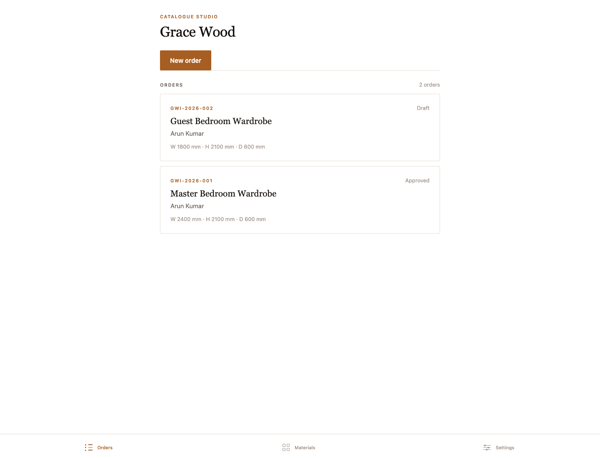
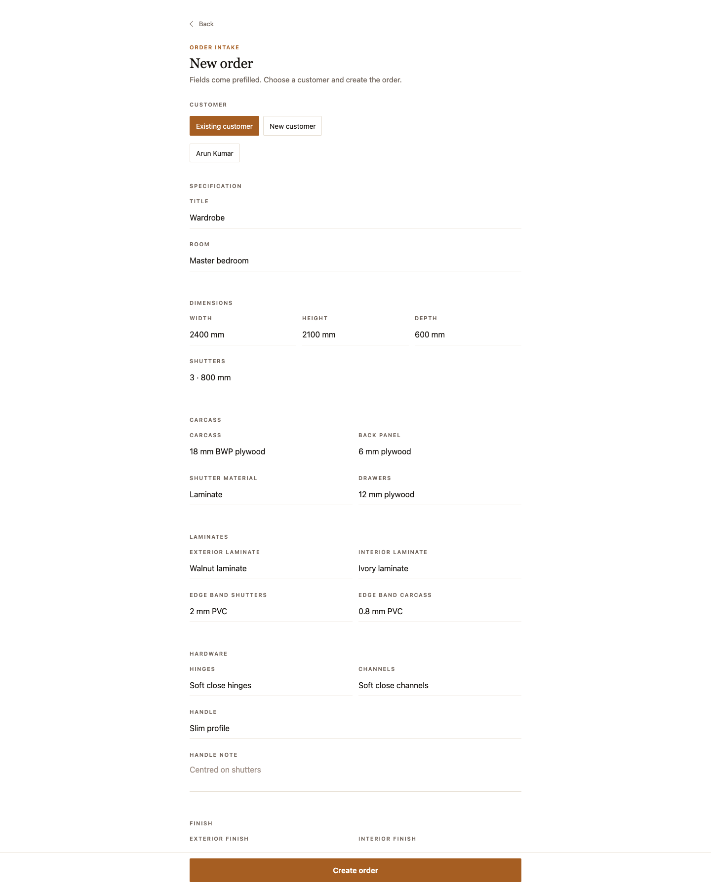

# Grace Catalogue Studio

An internal tool for Grace Wood Industry, Nagercoil. It turns a customer requirement into a finished, print ready document: an order confirmation voucher with the specification, the proposed finishes and the company's own photography.

One codebase. It runs as a phone app and as a website, built with React Native and Expo.

## What it does

1. A sales person picks a customer and enters the wardrobe specification.
2. The app asks the server to render the voucher.
3. The server fills the house templates with that data and prints them to PDF.
4. The PDF is previewed in the app, page by page, and can be shared or printed.

The design is fixed. The words are few. The photography carries the page.

## Screens



The order book. Every order carries its number, customer, title and dimensions.


The full specification, then the rendered voucher with page by page preview, open PDF and share.



One form, prefilled with the house standard. A person can create an order in under a minute.


The swatch library that feeds the finishes page of the voucher.


Thirty cover designs. The specification and finish pages stay identical, so picking a design is safe. Choose one from the order screen and the next render uses it.


## Architecture

```
app/          Expo SDK 58, expo-router, React Native and web
server/       Node 24, Hono, node:sqlite, WeasyPrint via child process
templates/    HTML and CSS for the voucher and the info kit
data/         SQLite database, generated PDFs and page images (git ignored)
```

The app never renders a document. It sends data and receives a PDF, so what a customer sees is always the same file, whether it was generated on a phone or on the office desktop.

```
React Native app  ──HTTP──▶  Hono API  ──SQLite──▶  orders
      ▲                         │
      │                         └── templates + WeasyPrint ──▶ PDF
      └──────── page images and PDF download ────────────────┘
```

## Quick start

Requirements: Node 24, Python 3 with WeasyPrint, and `pdftoppm` from Poppler.

```bash
python3 -m venv .venv
.venv/bin/pip install -r requirements.txt
```

```bash
npm run setup      # installs server and app dependencies
npm run seed       # creates data/catalog.db with demo data
npm run dev        # API on :8787 and the web app on :8081
```

Open http://localhost:8081 for the web app. For the phone, run `npm --prefix app start` and scan the QR code with Expo Go.

Useful single commands:

```bash
npm run server     # API only
npm run app        # web app only
npm --prefix server run previews   # build the 30 template thumbnails
npm test           # server test suite
npm run verify     # end to end check: create an order, render, verify the PDF
npm run build:web  # static web build in app/dist
node scripts/serve-web.mjs 8081   # serve that build with SPA deep link fallback
```

The web build is a single page app because of the dynamic order route. Any static host must rewrite unknown paths to `index.html`. `scripts/serve-web.mjs` does that for local review. Do not open the files with a file:// URL.

## The API

Full contract in [CONTRACT.md](CONTRACT.md). The essentials:

| Method | Path | Purpose |
|---|---|---|
| GET | `/api/bootstrap` | customers, orders and materials in one call |
| POST | `/api/orders` | create an order |
| POST | `/api/orders/:id/render` | render a voucher with an optional `templateId`, returns page URLs |
| GET | `/api/templates` | the 30 brochure templates and their thumbnail URLs |
| GET | `/previews/:templateId.png` | a template thumbnail |
| GET | `/files/:name` | the PDF |
| GET | `/pages/:renderId/:n.png` | a page image for the in app preview |

A voucher has 30 selectable designs: six cover layouts crossed with five
palettes. The catalogue is data in `templates/variants.json` and every design is
rendered by the single base template `templates/voucher/index.html`. The app
sends `templateId` with a render; missing means the first template. Thumbnails
are cached in `data/previews/` and generated once per template.

## Rendering

Templates live in `templates/`. The server replaces `{{key}}` tokens with order data, writes the HTML next to the template so relative asset paths resolve, then calls:

```
weasyprint <html> data/renders/<id>.pdf
pdftoppm -png -r 96 <pdf> data/renders/<id>
```

If a placeholder is left unfilled the render fails with a clear message rather than printing `{{customerName}}` on a customer's document.

Rendering is queued per process so two requests cannot write into the same build directory.

## Design system

| Token | Value |
|---|---|
| paper | `#FFFFFF` |
| ink | `#14100C` |
| muted | `#6E6259` |
| faint | `#A2938A` |
| copper | `#A65E22` |
| hairline | `#E6DED2` |

Display type is a serif, set large and tight. Body type is a neutral sans. Section labels are small, tracked, uppercase. No shadows, no gradients, no decoration.

House rules for copy: short sentences, no em dashes or en dashes, a middot for separators. Say what the person should do next, not what the system did.

## Tests

```bash
npm test          # 22 api and rendering tests
npm run verify    # black box: create, render, check the pdf with pdfinfo
npm run e2e       # drives the real web app in Chrome like a person
npm run typecheck
npm run lint
```

`npm run e2e` starts the API and the web build, then walks the product: order book, new order, create, detail, render, open PDF, share, re-render, choose a different design, materials, settings, deep link, mobile viewport, and the sad path when the API is down. It writes screenshots to `docs/screenshots/e2e/`. It fails on console errors.

## Design templates

Thirty covers are built from six compositions and five palettes:

| Compositions | Palettes |
|---|---|
| full bleed, split right, split left, band top, type only, centred | copper, ink, olive, indigo, sand |

`GET /api/templates` lists them with preview images. A render accepts `templateId`. The app shows the gallery from the order screen under Design.

## Deployment notes

The server is stateless apart from `data/`. To deploy, run it behind a reverse proxy with the `data/` directory on a persistent volume, set `PORT`, and point the app at it with `EXPO_PUBLIC_API_URL`. The web build in `app/dist` is static and can be served from any CDN.

Running on a device: the app defaults to `http://localhost:8787`, which is right for the web build and the iOS simulator. The Android emulator needs `EXPO_PUBLIC_API_URL=http://10.0.2.2:8787`, and a real phone needs the machine's LAN address, for example `EXPO_PUBLIC_API_URL=http://192.168.1.20:8787`.

Two things to check before a customer sees a document: the fonts in the PDF must all be embedded (they are, as CID TrueType subsets), and the images must be at least 200 dpi at their printed size. The cover render is the weakest file at roughly 150 dpi; a larger export from the original render would fix it.
