# Jacob Design Studio

An internal studio application for Jacob Design Studio, Nagercoil. A salesperson pastes what the customer asked for, attaches the project photographs, and the application designs and prints a customer brochure from those pictures.

One codebase: a phone app, a website and a standalone desktop application.

## One standalone app

The product is a single desktop application. The studio, the design engine, the local SQLite database and the print engine are inside the installer. There is no external server, no Python and no WeasyPrint on the customer's machine. A separate `npm run server` exists only for development from a checkout.

The only external service is the language model chosen in Settings. Everything else stays on the machine, and the server's egress guard enforces that.

## What it does

1. A salesperson pastes the customer requirement into the chat and attaches the project photographs.
2. The intake assistant pulls out the order and asks only for what is missing.
3. Before designing, the chat shows the pictures back with numbered circles on the details worth magnifying and the colours read from them, and asks what to magnify. The client answers in the chat.
4. The model designs and typesets a showroom brochure from the pictures: the kind a car or bike showroom hands over. Big hero photography, one idea per spread, named colour options like a paint card, feature callouts with dotted leaders and colour codes set outside the photograph, almost no text.
4. The PDF is previewed page by page and can be printed, opened or shared.

There is no template library and no pre-made layout. The model authors every page for that project.

## Pictures are the design

The photographs are the source, not decoration. The brochure is a colour study, not a specification sheet: there are no dimensions, sizes or shapes anywhere in the product.

- **Every uploaded picture is printed.** A document that leaves a picture out is rejected and asked for again. PDF sheets count as pictures too, through their first page.
- **Fortune 500 art direction.** The designer is briefed like an art director for a luxury brand book: a real grid, one type hierarchy, varied page compositions, full bleed photography, quiet detail, and a banned list that rules out template look, badges, cards, gradients and clip art.
- **World class gate.** Every design is scored 1 to 10 by an art director against a strict rubric. Below 8 it goes back with concrete fixes for another full design round, up to six rounds. The best scored round is kept and polished rather than failing, so the studio always receives the strongest version from that turn.
- **Two print review passes.** After the art director pass, the document is reviewed again for alignment on the grid and for anything that feels AI generated: gradients, shadows, invented icons, emoji, generic stacks, uneven spacing. Only a document that still passes every print check replaces the previous one.
- **A second art director pass.** After the designer produces a valid document, an art director prompt refines composition, hierarchy and rhythm. If the refinement breaks any print rule, the valid original is kept.
- **No order number in print.** The order number lives in the app and the database, never on a printed page.
- **The logo leads.** On the cover the brand plate must be 55 to 100 mm wide, prominent and given real space; the body mark stays a small quiet sign.
- **Pamphlet or brochure, chosen per order.** The chat and the order page both offer Pamphlet and Brochure. Pamphlet is a small take home piece with minimal copy; Brochure is a larger art directed book with story spreads, colour plates and callouts. The format is stored on the order and the agent passes it to the designer, so an edit keeps the chosen output until the studio changes it.
- **Length follows the input.** There is no target or cap on pages. A pamphlet needs at least a cover and a closing side, then as many sides as the pictures and story need. Every supplied picture is guaranteed at least one whole page; the studio adds a full picture side only for the pictures the design did not already show whole, so the page count is dynamic and no picture is ever left out.
- **Every picture is the hero.** Each uploaded photo is printed whole and uncropped, never a cropped background, and the studio adds a full picture material callout page for every picture with decoded details. There is no thumbnail appendix and no keyword sheet.
- **Material callout pages, drawn by the studio.** One page per picture with decoded details, the whole picture large, a small black ring on the exact point, a short black dashed leader with a black arrow, and the colour code and name outside the picture. Each callout takes the nearest side, top, bottom, left or right, so the line is as short as possible and the photograph keeps its space. No white halos, no loupe, no crop.
- **A style fingerprint is read from every picture.** The vision pass returns the room mood, visible materials, how the room is lit and how the picture is composed. Those notes drive the display voice and framing, and the art director judge sees them too, so a generic book that ignores the light and materials of the photographs scores lower. Colour is only one part of the inspiration.
- **The whole style signature comes from the pictures.** Palette, tone, warmth and contrast are mapped to concrete decisions: the page ground, the serif or sans display voice, the outer margin, the picture scale and the rule weight. Two picture sets cannot produce the same looking book. The designer must follow those decisions, and the palette lock removes invented colours.
- **The picture palette is the law.** Any literal colour the model invents that is not within the picture theme or a neutral tint is remapped to the nearest colour the pictures actually contain. The only exception is when the client states a colour preference in the chat or the order words; then their choice wins for that book.
- **The taste comes from the pictures.** Every order gets its own art direction computed from its photographs: palette shares, tone (light and airy, calm, or deep and low lit), warmth, contrast and the focal details seen. The brief tells the designer to invent a fresh concept for that set and never reuse a house layout; the page ground, ink, deep tone, accent and hairline all come from the picture palette through the theme variables.
- **Client words override, nothing else does.** If the customer asks for a colour, mood, motif, layout or detail in the chat, that request wins for that part of the book. Where the client is silent, the pictures decide everything.
- **Every picture read.** The vision pass reads every picture in batches of four, so a hundred page PDF is analysed page by page, not just the first four.
- **The mark stays quiet.** In the body the brand mark must be a small 8 to 14 mm sign, never a large logo, watermark or decoration over type. Large marks live only on the cover and closing plates.
- **Contrast is enforced.** Dark text on a light ground, light text on a dark ground. Every explicit text colour is checked against the colour actually behind it, including bands and photograph scrims, before the brochure prints. A pale-on-pale or dark-on-dark page is rejected and asked for again.
- **The theme comes from the pictures.** The paper, ink, deep tone and accent of every brochure are computed from the colours read out of the client's photographs and handed to the designer as the page palette. Two projects never share a house palette.
- **The brand is always legible.** The mark, the brand name and the company details are printed on ready made brand and contact plates. Each plate carries its own solid ground, light or dark, with a keyline, so a pale photograph or a dark page can never fade them out. The cover takes a brand plate and the closing page takes a brand plate plus a contact plate with the phone, email and address.


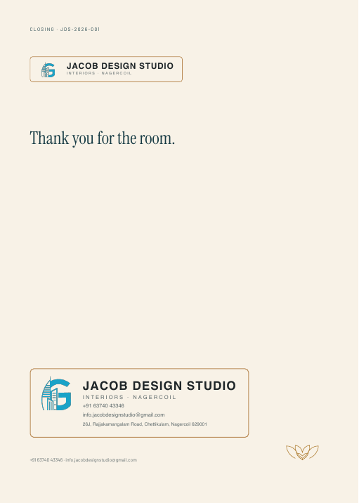

- **The palette comes from the pictures and gets showroom names.** The engine decodes each photograph, then names its four dominant colours the way a paint card does: Warm Ivory, Oat, Sand Beige, Walnut. The brochure prints colour option strips, four named swatch chips with their hex values, so the pages mirror the project instead of an invented palette.
- **The pages look like the project.** Type, photographs and colour are composed to belong with the pictures supplied.
- **The picture review.** As soon as pictures are attached the studio analyses them and shows each picture back large, with magnified circles on the details worth seeing. Each circle is a four times enlarged cut of that same picture and is named with the colour inside it, name plus hex code, so the client reads Oat #C9B996 or Walnut #794617 at a glance. The palette is printed under the picture with every code, and the studio asks what to magnify before any brochure exists.
- **The sheet text is read too.** When a PDF arrives, its printed words are extracted as well as its pages, so the room and the piece come from the client's own drawing title, not only from a file name.
- **Vision is the normal path.** The app sends up to four pictures in one call and gets back the room, the piece, the colours actually seen and the joinery details with focus points. Those words drive the confirmation question, name the circles in the picture review, and go into the designer brief so the pages are composed for the actual project.
- **It degrades safely.** If a model rejects image content, the failure is remembered for the session and the deterministic reading takes over. `LLM_VISION_MODE=auto` limits vision to known vision models and `off` disables it, so a text-only machine is never slowed.
- **PDF sheets are unpacked page by page.** The studio can send the design as a PDF. Every page is rendered on the machine (up to twelve), and each page joins the review as its own picture with its own circles and palette. The brochure has to print every page, exactly like every photograph, so nothing a client sent is dropped.


- **Material callouts.** Name a detail in the chat, such as a handle, an edge, a grain or the colour palette. The studio then prints the callout page for that picture: a small open ring on the exact point, a dotted leader with an arrow to the outer edge, and the colour code and name on paper outside the photograph. No loupe, no crop, no words over the picture. When pictures arrive without a named detail, the details seen by the vision pass are annotated automatically.

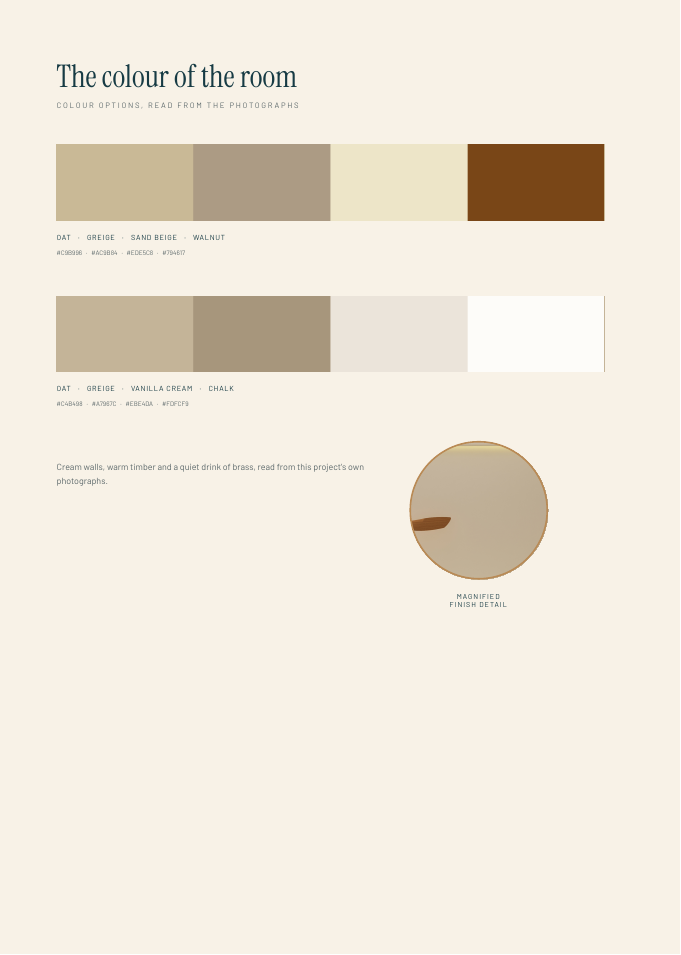

## The Pi agent

The chat is driven by the Pi agent harness (earendil-works/pi), as a Node SDK inside the server. Pi owns the agent loop, tool calling and transcript; this app supplies the studio tools and the model transport. Provider prompt cache savings are normalised into the usage report, so cached input tokens from OpenAI, DeepSeek and Anthropic style APIs are visible per turn.

- **Tools the agent can call**: `read_pictures` (vision reading of the attached pictures), `create_order`, `update_order`, `design_brochure` and `get_order`. Every tool calls the same validated HTTP routes the rest of the app uses, so the print contract still applies.
- **Model transport**: one OpenAI compatible request per turn through the same provider settings as the rest of the studio, including provider headers such as the OpenCode session id. Pi's own provider SDKs are not used for requests, only its agent runtime.
- **Conversation state**: every chat has a Pi session stored in SQLite. The full transcript, including tool calls and tool results, is restored on the next turn and across restarts, so edits continue the same order instead of starting over.
- **Guards**: one turn at a time per chat, one order per chat, the designer can only run for an existing order, and the model cannot create a second order by accident.
- **Failures keep the work**: if a turn fails or runs long after the order is created, the order and any render are returned and saved, with a reply saying what happened. Nothing is thrown away and no duplicate order is made.
- **Point sampling with suggestions.** When a mark is placed on a picture, the app samples the real pixel colour at that point, names it like a paint card, fills the colour name and code, and shows the nearest joinery details as one tap suggestions that move the ring to that detail.
- **Pages workspace**: a split screen with the document at 75 percent and the studio desk at 25 percent. It opens every picture and every PDF page in the app, with a page strip, zoom, marks pinned on the page, a live callout preview, a marks panel with swatches and codes, and the same Pi conversation beside it. No external PDF viewer.
- **Studio marks**: on any picture review the studio can tap the exact area, name the detail and its colour name and code. Marks are saved on the order and become authoritative callout specifications for the designer, which must print their exact name and code.
- **Modern settings**: compact header, clean cards for the language model and app details, quiet provider pills, black primary action, outline test and a quiet forget key.
- **Modern order book**: History is a searchable grid of cards with the pamphlet cover, customer, page count and one tap actions for chat, pages workspace, order and PDF.
- **ChatGPT style chat**: neutral canvas, a centered welcome, quiet suggestion chips, assistant answers as plain text, user messages in a soft grey bubble, and a floating rounded composer with a circular send. The model status and New order sit quietly in the header.
- **Live progress**: while a turn runs, the server publishes each stage. The chat shows the current step (reading the pictures, creating the order, designing the pages, checking the print) with the elapsed seconds and a trail of the steps already done.
- **Only path**: the chat is the agent. There is no second deterministic chat flow. If a turn fails, the chat reports the failure and keeps any order or render that was already made; the next message continues the same session.
- **Bundling**: Pi is bundled into the desktop server by esbuild, with a require shim for its dynamic imports. No Python, no sidecar, no extra runtime.
- **Time budget**: one agent turn can take several minutes because the design tool runs a full designer call with repairs. The desktop proxy allows 20 minutes, the agent allows 15, so the turn finishes instead of being cut off. The chat shows the work in progress.
- **Review stays**: when the agent reads the pictures, the same circled picture review with named colours appears in the chat before the brochure bubble.
- **Tests**: the browser suite runs the real Pi loop against a deterministic mock model that walks the studio tools, so the agent path itself is under test. The server suite also drives the agent offline with Pi's faux provider.

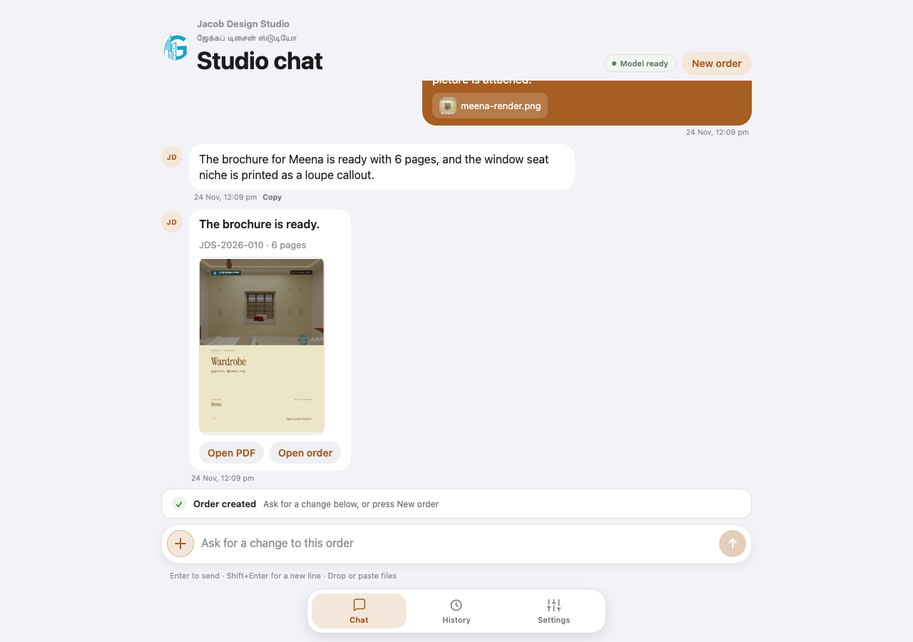

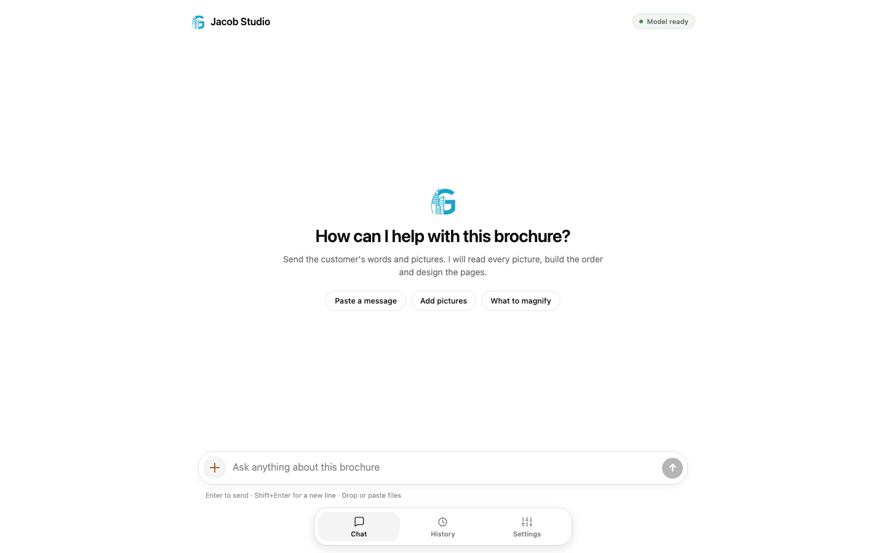

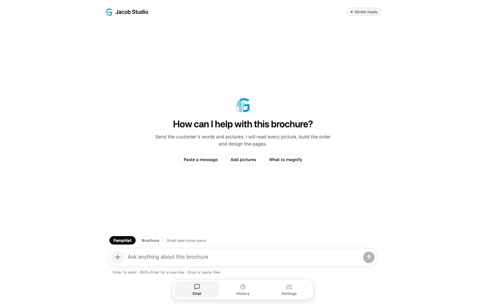

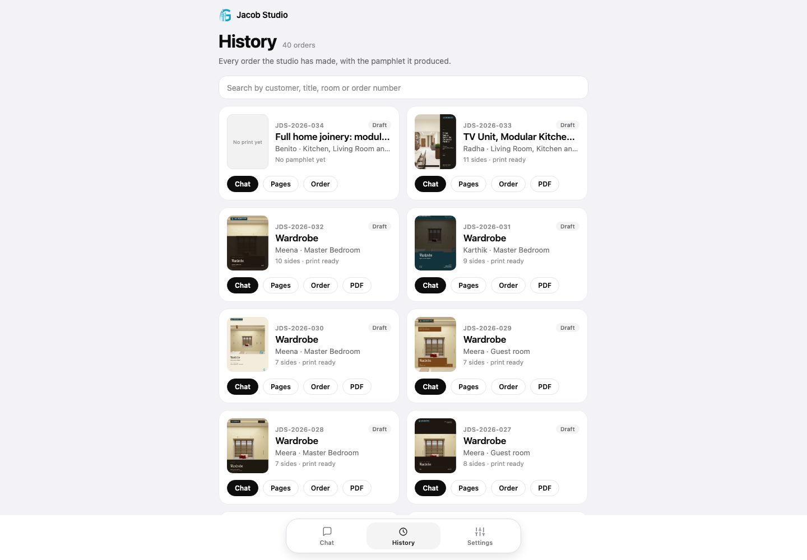

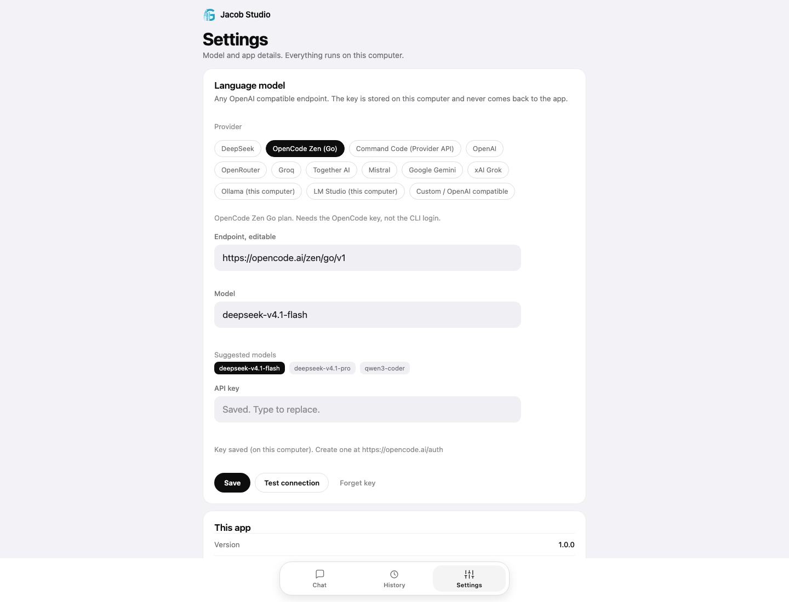

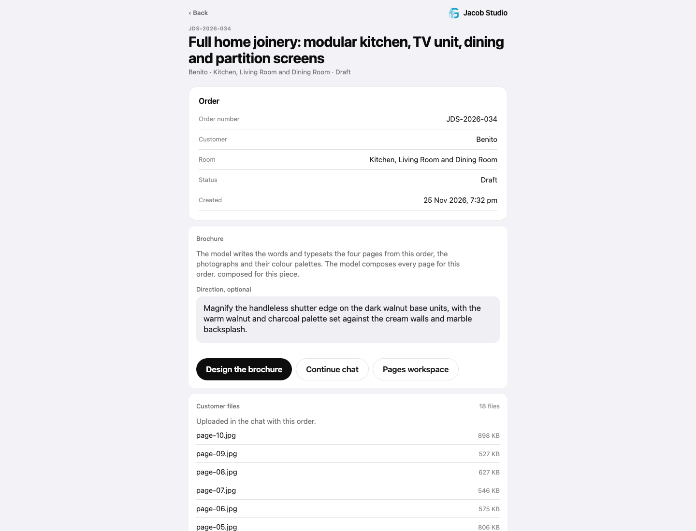

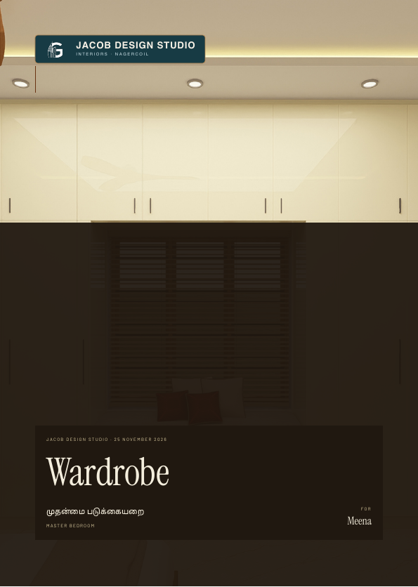

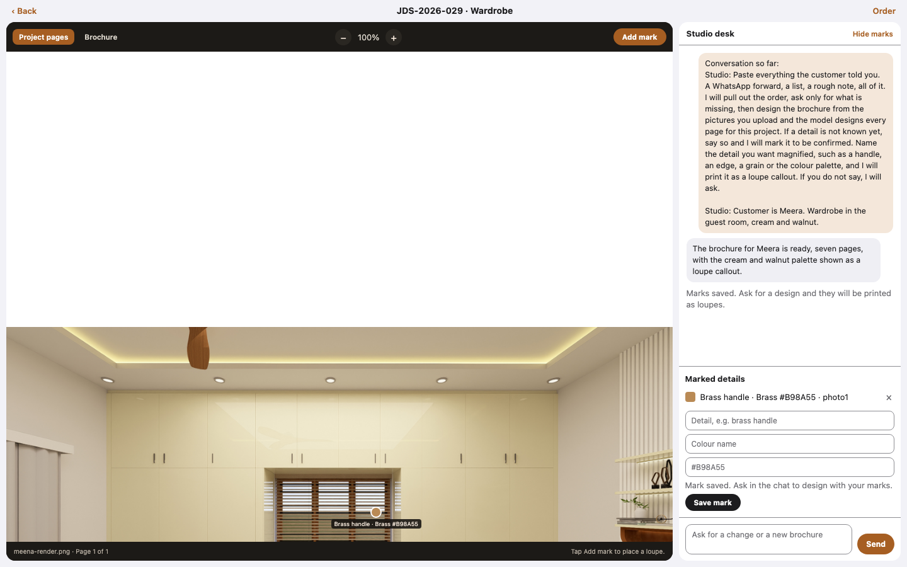

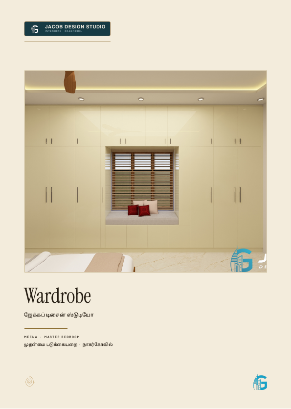

## Chat first

One chat is one order. It opens with the studio greeting, a date and time on every message, starter cards and a composer that takes typing, dragging or pasting.

- **Attachments**: any type up to 50 MB, picked, dragged or pasted. They wait in a tray with a thumbnail, size and remove button.
- **Never lost**: a failed send puts the message and files back in the composer and explains what happened.
- **The app reads the pictures, not asks for the brief.** Intake never asks for the room or the piece. It reads them from the pictures and the file names, says what it sees in one line and asks the customer to confirm. The only fact it asks for is who the customer is.
- **Nothing is invented**: a detail the customer does not know is marked to be confirmed, never guessed.
- **One conversation, one order**: after the brochure exists, every sentence edits that order. New order starts the next customer.

## Editing by conversation

After a brochure exists the same chat edits it. The sentence is applied to the order fields or the copy, then the designer is asked again with the brochure it already printed, so the design survives the edit. Examples: "make the shutters dark walnut", "magnify the brass handle", "shorten the headline", "the height is 2150".

Files can join late: attach a photograph with the next sentence and it is saved on the order and printed in the next brochure. Duplicates are ignored and the twenty file cap rejects the whole edit so nothing is half saved.

## Generated design

Quality is preferred over speed: a 32,000 token explicit output cap on the designer and the agent (omitting the field made some providers fall back to a small default and truncate the HTML), four repair attempts and an art director pass, so the provider uses the model's own maximum.

The model writes the words and authors the pages itself as HTML and CSS in one reply: four pages for a quiet order, up to eight when the photographs and their palettes need the room. The server supplies the print box, fonts, brand assets, the picture palettes and the words through tokens, then checks the document before printing.

The checks cover the page count, per page word limits, the copy printed once, every photograph used, every palette strip with its four named chips, the material callout pages with their rings, dashed leaders, colour names and codes, a brand plate on the cover, a brand plate and contact plate on the closing page, a house motif, no external URL, and no unfilled token. A failure is asked for again with the exact problems, up to four attempts.

The brochure carries the order's creation date. The story pages carry the copy, the colour pages carry the strips and chips, the material callout pages carry the ring, dashed leader and colour code outside the photograph, and the closing page carries the brand and contact plates.

## Brand assets only

The installer ships brand identity and nothing else: the Jacob Design Studio mark, the house motifs (jaali, paisley, lotus, rangoli, temple arch), the fonts and the print engine. Every room photograph and every finish photograph arrives through the studio's upload. A finish without a photograph prints as its exact colour chip from the materials table. No stock room, no stock wood, no borrowed image reaches a customer document.

The info kit follows the same rule: brand panels, the white mark and house ornaments over cream, never somebody else's wardrobe.

## Screens

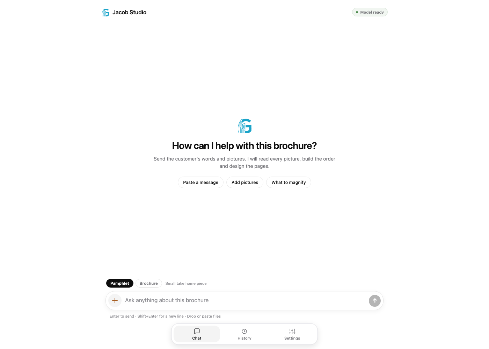

Chat. One order per conversation, pictures and requirement in one place.

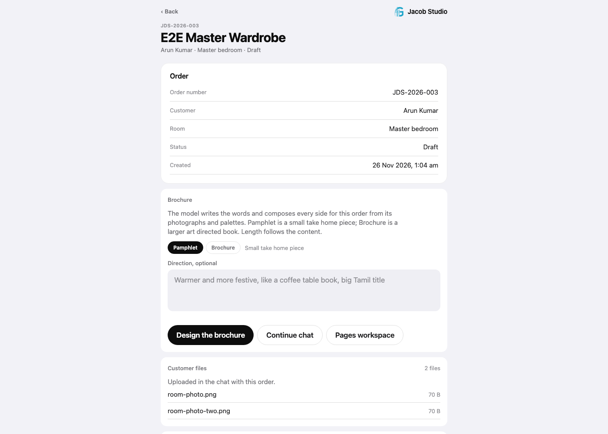

Order detail. Specification, brochure pages, PDF, customer note and info kit. Every order shows the date and time it was created.


History. Every order the chat made, with the brochure it produced.

## Architecture

```
app/          Expo SDK 58, expo-router, React Native and web
server/       Node 24, Hono, node:sqlite, the design engine and print queues
templates/    brand assets, fonts, the info kit, legacy print layouts
data/         SQLite database, uploaded media, generated PDFs and pages
```

```
React Native app  ──HTTP──▶  Hono engine  ──SQLite──▶  orders and uploads
      ▲                         │
      │                         └── model ──▶ brochure HTML ──▶ print engine
      └──────── page images and PDF download ────────────────┘
```

## Quick start

Requirements: Node 24. The desktop build embeds its own print engine. The development server uses WeasyPrint and Poppler.

```bash
npm run setup      # installs server, app and desktop dependencies
npm run seed       # creates data/catalog.db with demo data
npm run dev        # engine on :8787 and the web app on :8081
```

Useful commands:

```bash
npm test           # server suite
npm run verify     # create an order, attach photos, render, check the PDF
npm run e2e        # drive the real web app in Chrome
npm run typecheck
npm run lint
npm run desktop    # run the standalone app in development
npm run build:mac  # dmg and zip in desktop/release
npm run build:win  # nsis and portable exe, best on Windows
```

## Desktop app

The installer contains the studio UI, the engine, the database and the print engine. On first launch the studio opens Settings, chooses a language model and pastes its key. PDFs are printed by Electron's Chromium through `desktop/pdf-engine.js`.

Data lives in `%APPDATA%\Jacob Design Studio\data` on Windows and `~/Library/Application Support/Jacob Design Studio/data` on macOS.

The Windows installer is a custom NSIS wizard in `desktop/installer/JacobStudio.nsi`: welcome, options, install, finish. It installs for the current user into `%LOCALAPPDATA%\Programs\Jacob Design Studio`, creates Start Menu and optional desktop shortcuts, registers an uninstall entry and upgrades cleanly without touching data. Builds are unsigned, so SmartScreen and Gatekeeper warn on first open.

`.github/workflows/desktop.yml` builds both platforms on every `v*` tag, verifies a silent install and uninstall on the Windows runner and attaches the installer and portable exe to the release.

## Language model

The studio ships presets for DeepSeek, OpenCode Zen Go, Command Code Provider, OpenAI, OpenRouter, Groq, Together, Mistral, Google Gemini, xAI Grok, Ollama, LM Studio and Custom, all through one OpenAI compatible layer. The endpoint stays editable; switching provider drops a stale endpoint. The key is stored on the machine and never returned to the app or logged. No API key ships with the app.

## Tests

```bash
npm test          # server suite
npm run verify    # black box smoke test
npm run e2e       # 99 browser checks
npm run typecheck
npm run lint
```

The browser suite walks the product like a person: chat with date and time, picture-led intake, attachments, the colour chips read from the pictures, an order created the way the chat does, design, PDF, share, design again, note, info kit, edits, late files, settings, deep link, mobile and the API-down path. Screenshots land in `docs/screenshots/e2e/`.

## Offline by design

Everything except the model runs locally:

- The app, mark, motifs, fonts and print engine ship inside the installer. No CDN, no analytics, no update checks.
- The database is local SQLite; uploads, PDFs and page images live in the app data folder.
- The engine installs a network egress guard at boot: only the configured model provider and loopback may receive traffic.
- Print windows block every HTTP and HTTPS request, so a printed page can never pull a remote asset.
- Templates are audited for remote URLs and the guard has its own test.

## Production

The API can still run in a container: full runbook in [docs/DEPLOY.md](docs/DEPLOY.md) and the config template in [.env.example](.env.example). Health and readiness endpoints, request ids, rate limits, queued renders, retention and backups are documented there.

House rules for copy and interface: short sentences, no em dashes or en dashes, a middot for separators, say what the person should do next.
