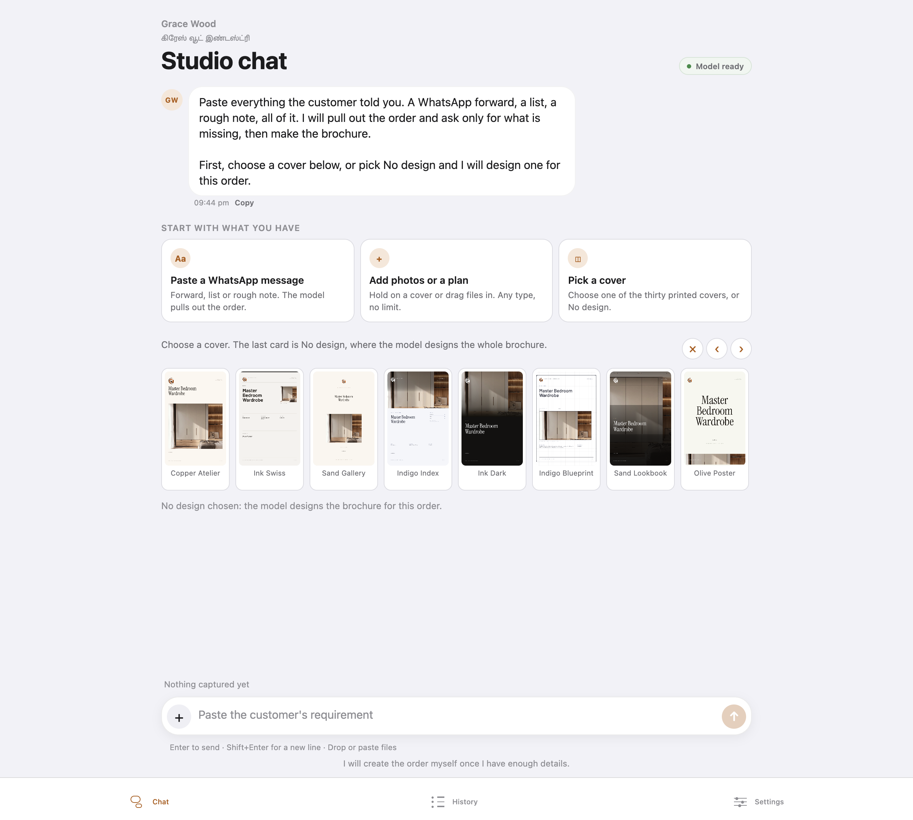
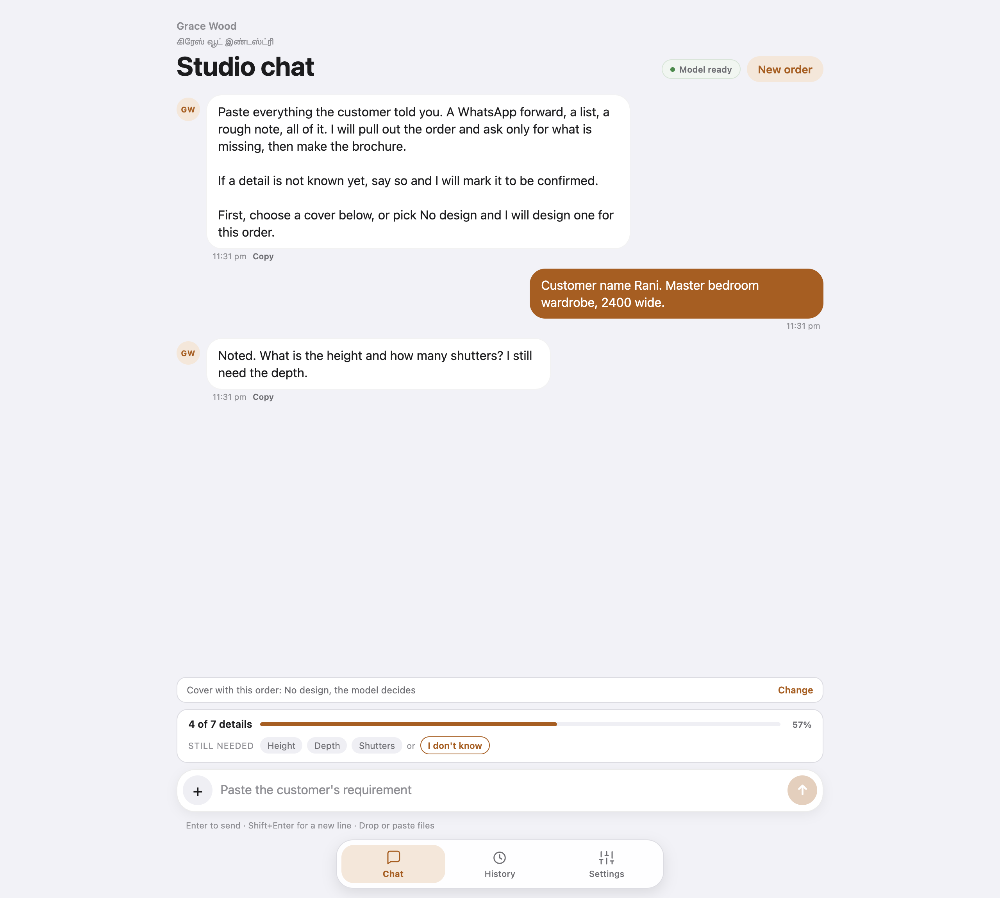
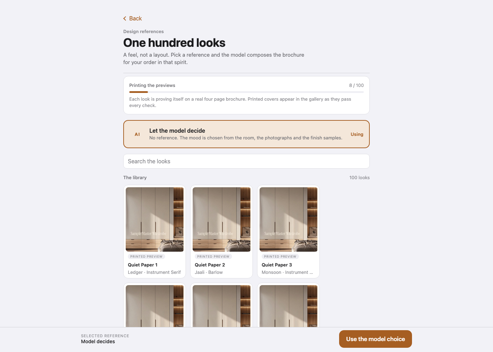
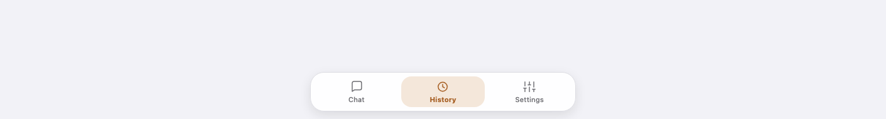
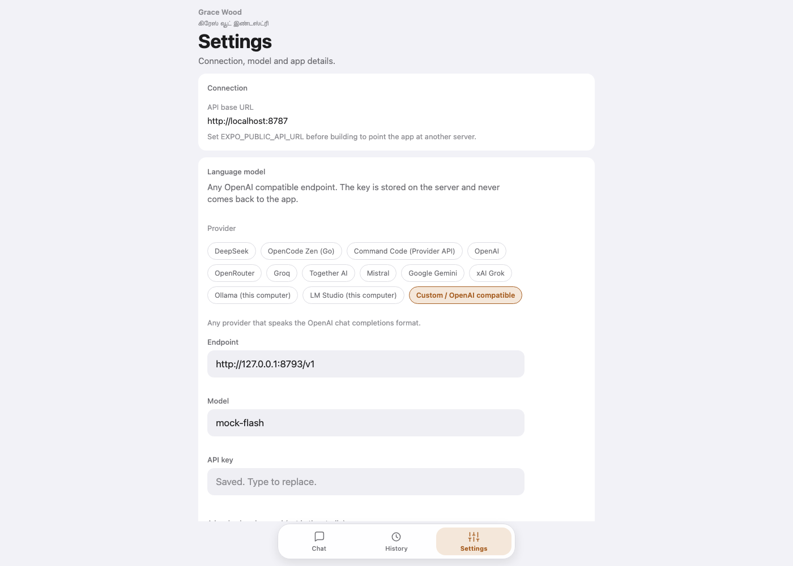

# Grace Catalogue Studio

An internal tool for Grace Wood Industry, Nagercoil. It turns a customer requirement into a finished, print ready brochure: the specification, the proposed finishes and the company's own photography, designed and typeset by a language model for that order.

One codebase. It runs as a phone app and as a website, built with React Native and Expo.

## One standalone app

The product is a single desktop application. The studio, the catalogue engine, the SQLite database, the brochure templates and the print engine are all inside the installer. There is no external server to run, no Python, no WeasyPrint and no browser. A separate `npm run server` exists only for development from a checkout; the customer never sees it.

The only external service is the language model chosen in Settings. Everything else works on the machine, and the server's egress guard enforces that.

## What it does

1. A sales person pastes the customer requirement into the chat and attaches photographs.
2. The app pulls out the order, asks only for what is missing, then designs the brochure.
3. The model writes the words and typesets all four pages for that order, guided by an optional look from the reference library.
4. The PDF is previewed in the app, page by page, and can be shared or printed.

No two brochures share a layout. The words are few. The photography carries the page.

## Documents

Three documents come out of the same data.

| Document | Where it starts | Pages | Notes |
|---|---|---|---|
| Brochure | Chat, or any order with Design the brochure | 4 | Designed and typeset by the model for that order |
| Info kit | Any order, Info kit | 5 | Company brochure: workshop, materials, process |


## Design direction and editing

The studio is never stuck with what the model chose. Anything can be changed, in plain words, in the chat or on the order screen.

- **Direction.** Type how the brochure should feel in plain words, for example "warmer and more festive, maroon and gold, big Tamil title, like a coffee table book". The model reads it before it designs, and the order remembers it for later generations.
- **Reference.** Pick one of the hundred looks in the gallery, or let the model decide. A reference only sets the feel: palette, type voice, mood and ornament. Every page is still composed for the order.
- **Chat edits.** After a brochure exists the same chat edits it: "make the shutters dark walnut", "try a calmer cover", "the height is 2150". The sentence is applied to the order and the existing pages are redesigned around it, never thrown away.
- **Regenerate.** Design the brochure runs the whole job again from the order, the photographs and the current direction and reference.

## Chat first

One chat is one order. It opens like a premium assistant: brand avatar, timestamps, copy on every reply, starter cards for the common jobs, and a composer that takes typing, dragging or pasting.

- **Starter cards**: paste a WhatsApp message, add photos or a plan, or pick a look from the reference strip.
- **Files**: attach with +, drag files onto the window, or paste an image. Any type, up to 50 MB each. Attachments wait in a tray with a thumbnail, size and remove button before sending.
- **Brief progress**: after the first reply the composer shows a progress bar, the details still missing as chips, and a Ready to build state.
- **Skipping what is not known**: press **I don't know** on the missing details, or type it in the chat. Those details are marked to be confirmed, never guessed. The order is still made, the specification prints To be measured, and the measured drawing says it will follow after the site measurement.
- **Keyboard**: Enter sends, Shift+Enter writes a new line, IME composition never sends early. A scroll to latest button appears when you are reading back.
- **Nothing is lost on failure**: a failed send puts the message and attachments back in the composer and explains how to fix it.
- **Model status**: a Model ready pill when the language model is configured, and an Add model banner that links straight to Settings when it is not.
- **Typing indicator** shows whether the model is Reading or Creating the order.
- **Reference strip**: a sideways scroll of looks the model wrote, with Model decides as the last card. It folds away after the first message and stays one tap away as a reference summary above the composer.





The chat offers a look before anything is designed: pick one of the reference cards, or leave it on **Model decides** and the mood is read from the room, the photographs and the finish samples. Either way every page is designed for this order.


Then paste everything the customer told you. A WhatsApp forward, a list, a rough note, all of it. The model pulls out the order, asks only for what is missing, and creates the order and the brochure when it has enough.

## Editing by conversation

After a brochure exists the chat stays on that order. Every plain sentence is treated as a change request: the model maps it to order fields or new copy, the server saves it, and the same sentence goes to the brochure designer, which changes the pages it already has. Examples: "make the shutters dark walnut", "try a calmer cover", "shorten the headline", "the height is 2150". An order only change like a new height keeps the design and corrects the facts. New order is the only way to start a different customer.

Files can join late too. Attach a photograph or a plan with the next sentence and it is saved on the order: the brochure re-renders with the new images in the set, and duplicates are ignored. Past the twenty file cap the whole edit is rejected so nothing is half saved.

## Generated design

There is no fixed template behind a brochure, and no fixed length either. When the chat finalises an order, the model writes the words and then authors the pages itself as HTML and CSS: one reply, one complete document, four pages for a quiet order and up to eight when the photographs, the story and the specification need the room. The server only supplies the print box, the fonts, the assets and the facts through tokens, then checks the document before anything is printed.

`POST /api/orders/:id/ai-brochure` designs and prints in one call and returns the render, the design note and the copy. The document is kept with the render, so the next chat edit changes the pages it already has instead of starting over. An optional `reference` id or an `edit` sentence steers the same call; a hand edited `copy` object wins over generated words.

Every order gets a different document, and every document must pass the same print checks:

1. **Cover.** The brand, the piece, the customer and a Tamil line over the photographs. Almost nothing else.
2. **Story.** The approved headline, body and closing set as an editorial spread with the photographs.
3. **Materials.** All four finish samples shown at size with their names. A colour page, not a table.
4. **Specification.** Every dimension, material and hardware fact with the measured drawing, set quietly at the back.

Printed in the Indian workshop voice: warm cream stock, deep maroon, muted gold rules, jaali, paisley, lotus, rangoli and temple arch motifs used like jewellery, Tamil and English together, generous margins, large type, very few words. An unreadable reply is asked for again with the exact problems listed; a reply that still fails reaches nobody.

## Design references

The gallery holds one hundred looks, and the model wrote every one of them. Each reference is a palette, a type voice, a mood and a cover idea, generated in four volumes of twenty five and stored in the database as it arrives, so the gallery fills while the studio browses. The first visit starts the build; later visits read it straight from the shelf.

A reference is a feeling, never a layout. The brochure designer reads its palette and mood and composes fresh pages for the actual order, the actual photographs and the actual facts. Nothing from a reference is ever printed itself.



Every reference then proves itself: the preview engine prints a complete brochure in its spirit from one fixed sample order, using the same prompt path, the same print checks and the same renderer as a customer brochure. Only a document that passes every check earns its cover image in the gallery; anything else is retried once and left for a later run. Previews build one at a time in the background and resume after a restart, so the gallery fills with printed covers while the studio works.

`GET /api/designs` serves the library with its build state and the preview counts. `POST /api/orders/:id/ai-brochure` accepts a `reference` id from it.


The extraction rules matter as much as the conversation. Bare dimensions become millimetres, counts become digits, unknown fields are dropped, and a reply without usable JSON is rejected with a readable error. A field is only ready when the customer actually said it, never guessed.

## Screens


History. Orders are only ever created by the chat, so this screen is read only: every order carries its number, customer, dimensions and the brochure it produced, with the cover thumbnail and a direct Open PDF.


The full specification, then the brochure with page by page preview, open PDF and share. The reference card shows the guiding look; direction is one field; Design the brochure runs the whole job again.


One hundred looks the model wrote. Picking one is safe: it only sets the feel, and the next design composes fresh pages around it.


## Architecture

```
app/          Expo SDK 58, expo-router, React Native and web
server/       Node 24, Hono, node:sqlite, WeasyPrint via child process
templates/    HTML and CSS for the voucher and the info kit
data/         SQLite database, generated PDFs and page images (git ignored)
```

The app never renders a document. It sends data and receives a PDF, so what a customer sees is always the same file, whether it was generated on a phone or on the office desktop.

```
React Native app  ──HTTP──▶  Hono API  ──SQLite──▶  orders
      ▲                         │
      │                         └── templates + WeasyPrint ──▶ PDF
      └──────── page images and PDF download ────────────────┘
```

## Quick start

Requirements: Node 24, Python 3 with WeasyPrint, and `pdftoppm` from Poppler.

```bash
python3 -m venv .venv
.venv/bin/pip install -r requirements.txt
```

```bash
npm run setup      # installs server and app dependencies
npm run seed       # creates data/catalog.db with demo data
npm run dev        # API on :8787 and the web app on :8081
```

Open http://localhost:8081 for the web app. For the phone, run `npm --prefix app start` and scan the QR code with Expo Go.

Useful single commands:

```bash
npm run server     # API only
npm run app        # web app only
npm --prefix server run previews   # build the 30 template thumbnails
npm test           # server test suite
npm run verify     # end to end check: create an order, render, verify the PDF
npm run build:web  # static web build in app/dist
node scripts/serve-web.mjs 8081   # serve that build with SPA deep link fallback
```

The web build is a single page app because of the dynamic order route. Any static host must rewrite unknown paths to `index.html`. `scripts/serve-web.mjs` does that for local review. Do not open the files with a file:// URL.

## The API

Full contract in [CONTRACT.md](CONTRACT.md). The essentials:

| Method | Path | Purpose |
|---|---|---|
| GET | `/api/bootstrap` | customers, orders and materials in one call |
| POST | `/api/orders` | create an order |
| POST | `/api/orders/:id/render` | render a voucher or kit with an optional `templateId`, returns page URLs |
| POST | `/api/orders/:id/ai-brochure` | design, typeset and print the brochure, accepts `brief`, `direction`, `reference`, `edit` and `copy` |
| POST | `/api/orders/:id/edit` | apply a plain language change to the order, returns whether to re-render |
| GET | `/api/designs` | the 100 model written design references with build state |
| GET | `/api/templates` | the classic house layouts and their thumbnail URLs |
| GET | `/previews/:templateId.png` | a classic layout thumbnail |
| GET | `/api/materials` | internal workshop finishes used by the brochure (no app screen) |
| PATCH | `/api/materials/:id` | update a material, including its trade rate |
| GET | `/files/:name` | the PDF |
| GET | `/pages/:renderId/:n.png` | a page image for the in app preview |

A brochure is designed per order, not selected. The app sends the order, the
photographs, the copy, a direction and an optional `reference` id; the model
authors the four pages itself. The classic house layouts still exist underneath
for the voucher and kit paths: ten complete document families in
`templates/voucher/families/`, catalogued in `templates/variants.json` with
three palettes each, rendered with `templateId` and cached as thumbnails in
`data/previews/`.

## Rendering

Model authored brochures are checked, not trusted: exactly four pages, every
fact and material token printed once, no external URL, no clipped content, no
em dash or en dash reaching print. The server fills the tokens with order data,
writes the built HTML into `templates/voucher/` so relative asset paths
resolve, then calls:

```
weasyprint <html> data/renders/<id>.pdf
pdftoppm -png -r 96 <pdf> data/renders/<id>
```

Classic layouts live in `templates/`. The server replaces `{{key}}` tokens with order data, writes the built HTML into `templates/voucher/` (or `templates/kit/`) so relative asset paths resolve, then calls the same two commands:

```
weasyprint <html> data/renders/<id>.pdf
pdftoppm -png -r 96 <pdf> data/renders/<id>
```

If a placeholder is left unfilled the render fails with a clear message rather than printing `{{customerName}}` on a customer's document.

Rendering is queued per process so two requests cannot write into the same build directory.

## Design system

| Token | Value |
|---|---|
| background | `#F2F2F7` |
| surface | `#FFFFFF` |
| fill | `#EFEFF4` |
| ink | `#1C1C1E` |
| muted | `#6E6E73` |
| faint | `#8E8E93` |
| copper | `#A65E22` |
| hairline | `#DCDCE2` |

The navigation is a floating dock on a wide window and a full width bar on a phone: line icons, an active tinted tab, hover states on desktop and Alt+1, 2, 3 shortcuts between Chat, History and Settings.

 The rest of the application follows Apple's grouped interface: the system font at native sizes, white cards on a grouped grey background, one brand tint, 14 point rounded cards, pill buttons and an iOS style tab bar. Printed brochures keep their own editorial typography; only the app is Apple styled.

House rules for copy: short sentences, no em dashes or en dashes, a middot for separators. Say what the person should do next, not what the system did.

## Tests

```bash
npm test          # 105 server tests, api, rendering, the model and uploads
npm run verify    # black box: create, render, check the pdf with pdfinfo
npm run e2e       # drives the real web app in Chrome like a person
npm run typecheck
npm run lint
```

`npm run e2e` starts the API, the web build and a mock model provider, then walks the product like a person: history, an order created the way the chat does, detail, design, open PDF, share, design again, pick a design reference and prove the render followed it, test the model connection, draft a customer note, render the info kit, the chat creating its own order and brochure, chat edits to the live order, settings, deep link, mobile viewport, and the sad path when the API is down. 98 checks. Screenshots land in `docs/screenshots/e2e/`. The run fails on console errors.

## Design references


One hundred looks, and the model wrote every one of them. Each reference is a palette, a type voice, a mood and a cover idea, generated in four volumes of twenty five. The gallery fills volume by volume while the studio browses, and the choice only sets the feel: every page is still composed for the order, its photographs and its facts.

| Volume | Character |
|---|---|
| Warm traditional | Deep maroon, muted gold, cream paper, a temple quiet |
| Modern editorial | Cream and charcoal, enormous photographs, wide quiet margins |
| Colour and craft | Teal, indigo, olive and copper led by the finish samples |
| Ornament and celebration | Jaali, lotus, rangoli and temple arches, gold used like jewellery |

Measured, not asserted: `GET /api/designs` must return 100 references with unique ids and names, varied families, complete palettes and known ornaments before the suite passes. The classic house layouts underneath are untouched and keep their own uniqueness check.

## Desktop app for Windows and Mac

The product ships as a standalone desktop app. It contains the studio UI, the catalogue API, the SQLite database and the print engine, so the person installing it needs nothing else: no Node.js, no Python, no WeasyPrint, no separate server. On first launch they open **Settings → Language model**, paste the endpoint, model id and key, and work.

PDFs are printed by Electron's own Chromium through `desktop/pdf-engine.js`. The server asks the engine for the PDF and the page images, so the rendering that used to need WeasyPrint and poppler now runs inside the app.

Data lives in the app data folder: `%APPDATA%\Grace Studio\data` on Windows and `~/Library/Application Support/Grace Studio/data` on macOS. The menu item **Open data folder** reveals it.

```bash
npm run setup
npm run desktop                      # run the desktop app in development
npm run build:mac                    # dmg and zip in desktop/release
npm run build:win                    # nsis and portable exe, best run on Windows
```

The desktop process starts the server itself through `server/src/boot.mjs`. The command line server still works the same way with `npm run server`, and `CATALOG_API_URL` switches the desktop wrapper to an external API for development.

The Windows installer is a custom NSIS wizard in `desktop/installer/GraceStudio.nsi`, built the same way as the Attendance Report Studio installer: Welcome, options, install, Finish with a Launch checkbox. It installs for the current Windows user into `%LOCALAPPDATA%\Programs\Grace Studio`, so there is no administrator prompt, creates a Start Menu shortcut and optionally a desktop shortcut, registers a proper Apps and Features uninstall entry, and upgrades cleanly. Data in the app data folder is never touched.

`.github/workflows/desktop.yml` builds both installers on every `v*` tag and attaches them to the GitHub release: `Grace.Studio.Setup.1.0.16.exe` and a portable exe for Windows, dmg and zip for macOS. The Windows job also installs the wizard silently on the runner, checks that the app landed at the expected path, then uninstalls it to prove both directions work. Builds are unsigned for now: SmartScreen and Gatekeeper will warn on first open.

The standalone app was built and launched on this machine: the packaged build started its embedded server, designed a brochure with the live model, and printed all four pages through the Electron engine in 1.5 seconds.

## Language model

The studio ships with presets for the providers people actually use, all through one OpenAI compatible layer: DeepSeek, OpenCode Zen Go, Command Code Provider, OpenAI, OpenRouter, Groq, Together, Mistral, Google Gemini, xAI Grok, Ollama and LM Studio, plus Custom for anything else. Pick one on the Settings screen, paste the key, choose a suggested model or type your own.



- Each preset fills its endpoint and suggests its models; the endpoint stays editable.
- OpenCode Go adds its session header automatically and asks reasoning models for a direct answer.
- Command Code uses its Provider API endpoint, `https://api.commandcode.ai/provider/v1`, with the same key as the CLI.
- Ollama and LM Studio run on the office machine and need no key.
- Switching provider drops a stale endpoint so the new defaults apply instead of an old URL.
- The catalog is available at `GET /api/llm/providers`; the key is stored on the server, never returned to the app and never logged.
- Server environment variables still work for deployments: `LLM_PROVIDER`, `LLM_ENDPOINT`, `LLM_MODEL`, `LLM_API_KEY`.

No API key ships with the app. A fresh install has none; the studio adds one on the Settings screen, and Forget saved key removes it from the computer.

## Model caching

Every generated reply is cached locally, keyed by a hash of the provider, the model and the full prompt. A repeated request returns the stored words with `cached: true` and `latencyMs: 0`, and does not call the provider at all. `regenerate: true` bypasses the cache and replaces the entry, so a fresh copy is never shadowed by an older one.

Measured live against OpenCode Go:

| Request | Result |
|---|---|
| First copy | 4,259 ms, `cached: false` |
| Identical second copy | 0 ms, `cached: true` |
| Regenerate | 4,568 ms, fresh copy stored |

The same applies to the customer note. `GET /api/llm/cache/stats` reports entries and hits, `POST /api/llm/cache/purge` clears it, and `LLM_CACHE_TTL_HOURS` sets the window (default 168, 0 disables). Expiry is enforced on read and expired rows are pruned at boot.

The system prompt is also a stable prefix at the start of every request, which is what provider side prompt caching keys on. The provider's cached token count already appears in the usage figures, so the two layers stack.

## Copy quality

The model's brochure copy is measured, not eyeballed. `scripts/ai-quality.mjs` runs six realistic orders through the live provider and scores every reply against a rubric: body between 95 and 145 words, headline and closing caps, numbers that exist in the order, no money, date or festival leaks, no talk of the order or brief, no durability or cleanliness claims, no parts the order does not include, no repeated verbs, no reused example phrasing, and no walking through the materials list.

The voice itself is checked: no marketing clichés (premium, luxurious, bespoke, stunning, perfect, elegant and friends), no second person selling ("you", "your", "we"), at least one long sentence balanced by short ones, no colon in the headline, and a limit on crutch words like quiet, calm and plane.

```bash
# measure the prompt directly
LLM_ENDPOINT=https://opencode.ai/zen/go/v1 LLM_MODEL=deepseek-v4.1-flash LLM_API_KEY=... \
  node scripts/ai-quality.mjs

# or measure the running product, repair pass included
node scripts/ai-quality.mjs --api http://localhost:8787
```

Final result across six orders: **118 of 120 checks, average body 114 words, zero repair passes needed** on the measured run.

The generator protects itself in production. `copyQualityIssues` rejects a thin body, internal paperwork talk, repeated verbs, a material walk through, any mention of the carcass or back panel, a marketing cliché, and second person selling. A single corrective retry names the exact problems, so a weak reply does not reach the customer.

Two bodies from the final runs:

> **Loft above for the winter bedding**
> Anitha's bedroom has little floor to spare, so the wardrobe runs 2400 mm across one wall and stops at 2100 mm, with a loft added on top for the bedding that used to sit in bags. Four drawers sit below the hanging space, and two of them lock, which keeps documents and jewellery out of the everyday shuffle. Warm oak laminate on the shutters lightens the room, and the white interior means a shelf is easy to read at a glance.

> **Three shutters for the guest room wall**
> The guest room holds its light on the long wall, and the wardrobe takes that wall from end to end. Three shutters divide the width into equal parts, each one hinged to close softly rather than snap, so the proportions read before the handles do. Matte black aluminium runs vertically down the face, one set to each shutter, and the edge banding follows the same colour as the laminate so the outline stays unbroken. Inside, white laminate keeps the interior bright when the doors are open.

## Offline by design

The only external service the studio uses is the language model you configure. Everything else runs on the machine:

- The app, its fonts, images, templates and brochure assets are bundled. No CDN, no Google Fonts, no analytics and no update checks.
- The database is local SQLite, attachments and PDFs live in the app data folder, and the desktop print engine is the Electron build itself.
- The server installs a network egress guard at boot. Only the configured model provider and loopback may receive a request. A stray future fetch to any other host throws instead of leaving the machine, and redirects are never followed off the allowlist.
- The desktop print windows additionally block every HTTP and HTTPS request, so a brochure from a local file can never pull a remote font or image.
- A test audits the templates for remote URLs, and the egress guard has its own test.
- The connection test and every model call go to the provider chosen in Settings. External links open only when a person clicks a PDF or a file link.
- There is no auto-update service. A new version is installed with the setup wizard.

If a future integration genuinely needs another origin, `CATALOG_ALLOWED_EGRESS_ORIGINS` adds that exact origin and nothing else.

## Production

The API ships as a container. Full runbook in [docs/DEPLOY.md](docs/DEPLOY.md), the config template in [.env.example](.env.example).

```bash
cp .env.example .env      # set CORS_ORIGINS and the domain
mkdir -p data && sudo chown 1000:1000 data
docker compose up -d --build
curl -fsS localhost:8787/health
curl -fsS localhost:8787/ready
```

The image installs WeasyPrint and Poppler, runs as a non root user, and keeps everything stateful in `/app/data`, which is bind mounted to `./data`. The web build is static, served by the same reverse proxy at the apex path, so the app and the API share an origin and `EXPO_PUBLIC_API_URL` can stay unset.

**Operational behaviour**

| Concern | How it behaves |
|---|---|
| Liveness | `GET /health`, cheap, always 200 while the process runs |
| Readiness | `GET /ready`, 200 only when the database answers and the WeasyPrint binary is executable, 503 with a reason otherwise |
| Logs | one JSON line per request to stdout: time, level, requestId, method, path, status, durationMs. No request bodies |
| Tracing | every response carries `X-Request-Id`, and every error JSON repeats it |
| Errors | JSON `{ error, requestId }`, never a stack trace to the client |
| Limits | 120 requests per minute per IP, 12 renders per minute per IP, 64 KB body cap, configurable by env |
| CORS | explicit allowlist, `*` only for testing |
| Storage | WAL mode, foreign keys on, schema versioned through PRAGMA user_version |
| Renders | concurrent identical requests share one render, files older than `RENDER_RETENTION_DAYS` are swept daily |
| Shutdown | SIGTERM drains in flight renders for up to 20 seconds, then closes the database |
| Backup | `sqlite3 data/catalog.db ".backup data/backup.db"` plus a copy of `data/renders` and `data/previews` |

Behind a proxy, keep the API on loopback and let Caddy hold TLS. The container reads the first `X-Forwarded-For` entry for rate limiting, which is only trustworthy behind that proxy. The Caddyfile in DEPLOY.md handles `/api`, `/files`, `/pages`, `/previews`, `/media`, `/health` and `/ready`, and falls back to `index.html` for the single page web app.

**Native builds.** `app/eas.json` defines development, preview and production profiles. Set `EXPO_PUBLIC_API_URL` for the target API before building. On the Android emulator use `http://10.0.2.2:8787`; on a real phone use the machine's LAN address or the deployed domain.

**Before a customer sees a document.** Fonts in the PDF must all be embedded (they are, as CID TrueType subsets), and images must be at least 200 dpi at their printed size. The cover render is the weakest file at roughly 150 dpi; a larger export from the original render would fix it.
