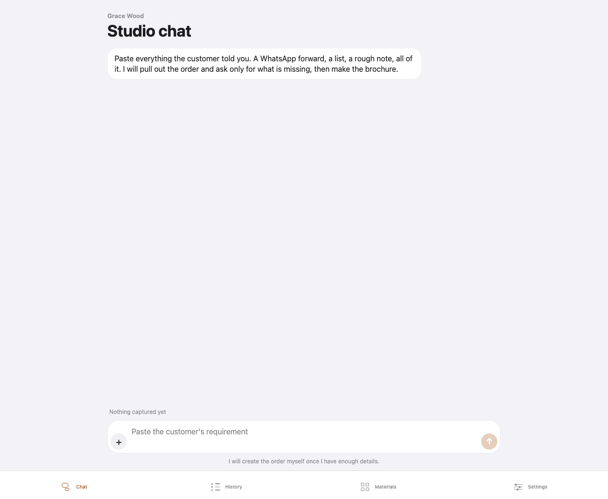
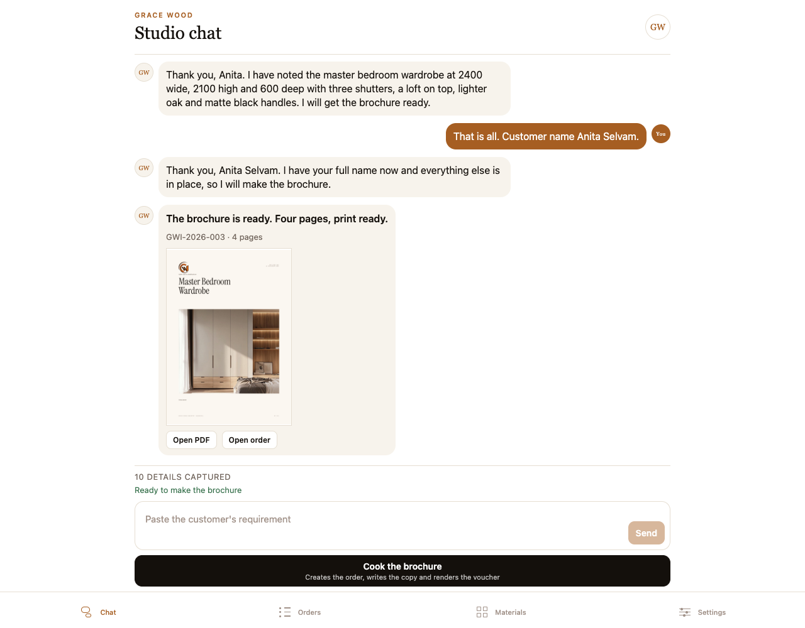
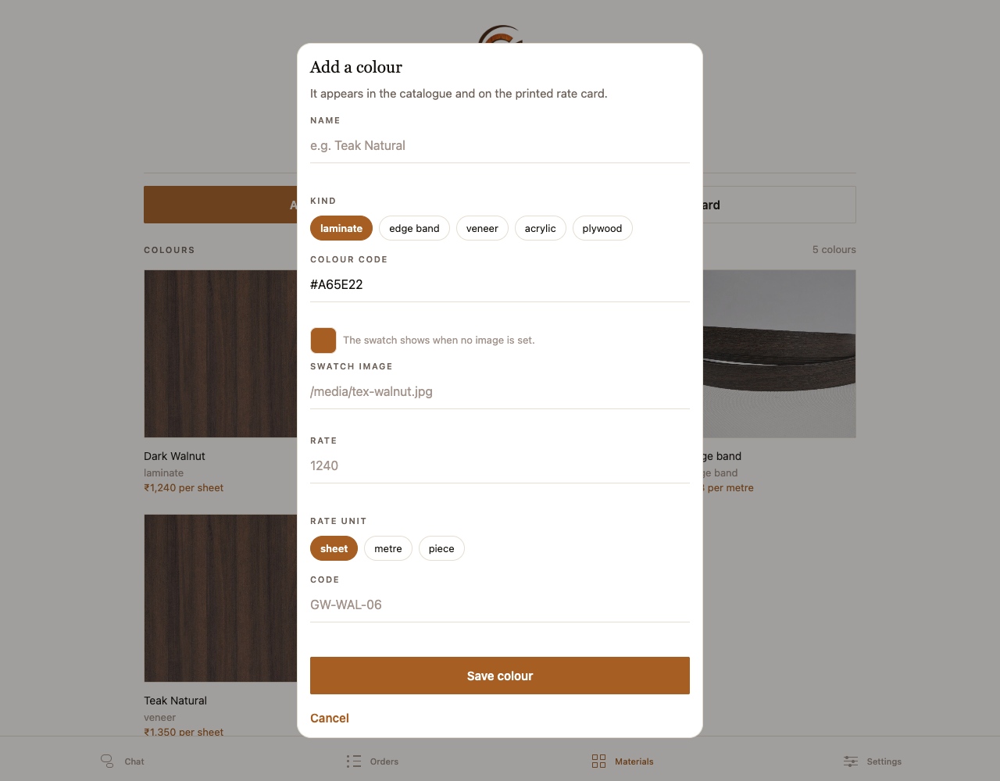
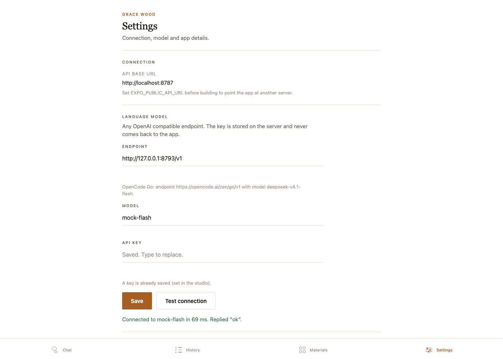
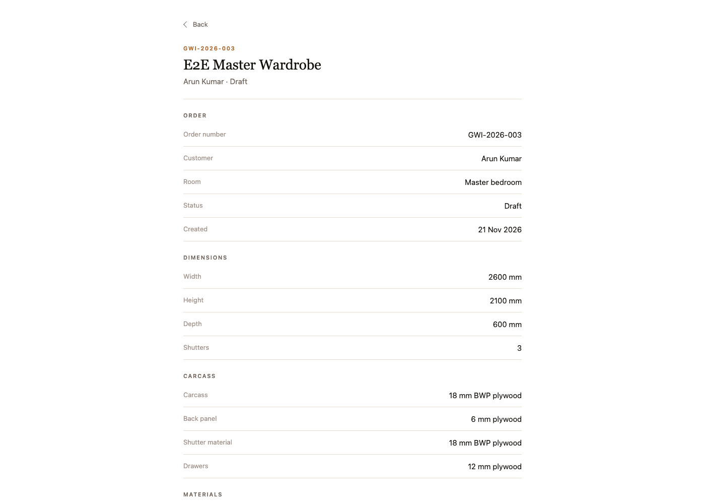
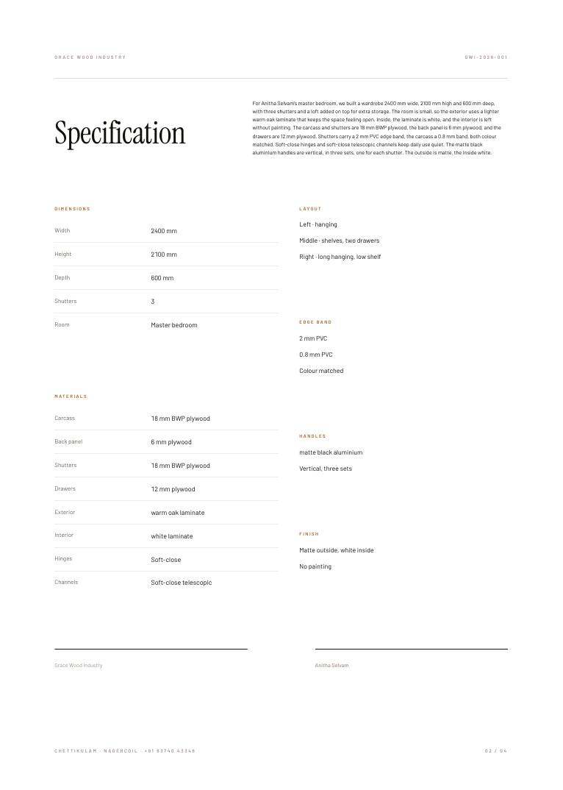

# Grace Catalogue Studio

An internal tool for Grace Wood Industry, Nagercoil. It turns a customer requirement into a finished, print ready document: an order confirmation voucher with the specification, the proposed finishes and the company's own photography.

One codebase. It runs as a phone app and as a website, built with React Native and Expo.

## What it does

1. A sales person picks a customer and enters the wardrobe specification.
2. The app asks the server to render the voucher.
3. The server fills the house templates with that data and prints them to PDF.
4. The PDF is previewed in the app, page by page, and can be shared or printed.

The design is fixed. The words are few. The photography carries the page.

## Documents

Three documents come out of the same data.

| Document | Where it starts | Pages | Notes |
|---|---|---|---|
| Order voucher | Any order, Design gallery | 4 | 30 designs, one per family, model-written body |
| Info kit | Any order, Info kit | 5 | Company brochure: workshop, materials, process |


## Chat first

The studio opens on a chat, not a form. The client dumps everything they know in one message: a WhatsApp forward, a list, a rough note. The model pulls out the order, asks only for essentials that are still missing, and says when it has enough.



The assistant keeps asking until it has enough: customer, piece, room, width, height, depth, shutters. Then it creates the order by itself, writes the copy with the same model, renders the voucher and shows the first page in the conversation, with Open PDF and Open order. Nothing is pressed to make that happen.

One chat is one order. Once the brochure is in the conversation, the next message starts a clean chat for the next customer, and the header button starts a new order at any time.

There is no manual order form anywhere. An order exists only after the chat has asked for every missing detail and finalised it. History is read only: it lists each order with the documents it produced, the brochure cover, the page count and a direct Open PDF, so every generated file stays reachable.



The extraction rules matter as much as the conversation. Bare dimensions become millimetres, counts become digits, unknown fields are dropped, and a reply without usable JSON is rejected with a readable error. A field is only ready when the customer actually said it, never guessed.

## Screens


History. Orders are only ever created by the chat, so this screen is read only: every order carries its number, customer, dimensions and the brochure it produced, with the cover thumbnail and a direct Open PDF.


The full specification, then the rendered voucher with page by page preview, open PDF and share.


The swatch library that feeds the finishes page of the voucher. **Add colour** opens a form for the name, kind, colour code, swatch image and code. The image can be uploaded from the photo library or pasted as an address, and the new colour appears in the grid immediately. Prices are not shown while trade rates are unpublished.




Thirty cover designs. The specification and finish pages stay identical, so picking a design is safe. Choose one from the order screen and the next render uses it.


## Architecture

```
app/          Expo SDK 58, expo-router, React Native and web
server/       Node 24, Hono, node:sqlite, WeasyPrint via child process
templates/    HTML and CSS for the voucher and the info kit
data/         SQLite database, generated PDFs and page images (git ignored)
```

The app never renders a document. It sends data and receives a PDF, so what a customer sees is always the same file, whether it was generated on a phone or on the office desktop.

```
React Native app  ──HTTP──▶  Hono API  ──SQLite──▶  orders
      ▲                         │
      │                         └── templates + WeasyPrint ──▶ PDF
      └──────── page images and PDF download ────────────────┘
```

## Quick start

Requirements: Node 24, Python 3 with WeasyPrint, and `pdftoppm` from Poppler.

```bash
python3 -m venv .venv
.venv/bin/pip install -r requirements.txt
```

```bash
npm run setup      # installs server and app dependencies
npm run seed       # creates data/catalog.db with demo data
npm run dev        # API on :8787 and the web app on :8081
```

Open http://localhost:8081 for the web app. For the phone, run `npm --prefix app start` and scan the QR code with Expo Go.

Useful single commands:

```bash
npm run server     # API only
npm run app        # web app only
npm --prefix server run previews   # build the 30 template thumbnails
npm test           # server test suite
npm run verify     # end to end check: create an order, render, verify the PDF
npm run build:web  # static web build in app/dist
node scripts/serve-web.mjs 8081   # serve that build with SPA deep link fallback
```

The web build is a single page app because of the dynamic order route. Any static host must rewrite unknown paths to `index.html`. `scripts/serve-web.mjs` does that for local review. Do not open the files with a file:// URL.

## The API

Full contract in [CONTRACT.md](CONTRACT.md). The essentials:

| Method | Path | Purpose |
|---|---|---|
| GET | `/api/bootstrap` | customers, orders and materials in one call |
| POST | `/api/orders` | create an order |
| POST | `/api/orders/:id/render` | render a voucher with an optional `templateId`, returns page URLs |
| GET | `/api/templates` | the 30 brochure templates and their thumbnail URLs |
| GET | `/previews/:templateId.png` | a template thumbnail |
| GET | `/api/materials` | materials with `priceAmount`, `priceUnit` and `sku` |
| PATCH | `/api/materials/:id` | update a material, including its trade rate |
| GET | `/files/:name` | the PDF |
| GET | `/pages/:renderId/:n.png` | a page image for the in app preview |

A voucher has 30 selectable designs: ten complete document families with their
own cover, specification, finishes and inside pages, each offered in three
palettes. The catalogue is data in `templates/variants.json`; every family is a
full four page HTML document in `templates/voucher/families/`, and the palette
arrives as CSS variables. The app sends `templateId` with a render; missing
means the first template (`atelier-copper`). Thumbnails are cached in
`data/previews/` and generated once per template.

## Rendering

Templates live in `templates/`. The server replaces `{{key}}` tokens with order data, writes the built HTML into `templates/voucher/` (or `templates/kit/`) so relative asset paths resolve, then calls:

```
weasyprint <html> data/renders/<id>.pdf
pdftoppm -png -r 96 <pdf> data/renders/<id>
```

If a placeholder is left unfilled the render fails with a clear message rather than printing `{{customerName}}` on a customer's document.

Rendering is queued per process so two requests cannot write into the same build directory.

## Design system

| Token | Value |
|---|---|
| paper | `#FFFFFF` |
| ink | `#14100C` |
| muted | `#6E6259` |
| faint | `#A2938A` |
| copper | `#A65E22` |
| hairline | `#E6DED2` |

Display type is a serif, set large and tight. Body type is a neutral sans. Section labels are small, tracked, uppercase. No shadows, no gradients, no decoration.

House rules for copy: short sentences, no em dashes or en dashes, a middot for separators. Say what the person should do next, not what the system did.

## Tests

```bash
npm test          # 87 server tests, api, rendering, the model and uploads
npm run verify    # black box: create, render, check the pdf with pdfinfo
npm run e2e       # drives the real web app in Chrome like a person
npm run typecheck
npm run lint
```

`npm run e2e` starts the API, the web build and a mock model provider, then walks the product like a person: order book, new order, create, detail, render, open PDF, share, re-render, choose a different design, test the model connection, draft a customer note, write the brochure body, confirm the body inside the generated PDF, render the info kit, add a colour with an uploaded image, materials, settings, deep link, mobile viewport, and the sad path when the API is down. 94 checks. Screenshots land in `docs/screenshots/e2e/`. The run fails on console errors.

## Design templates


Thirty designs, and every one is a **different document**, not a recolor. Each design is a complete four page family with its own cover, specification page, finishes page and inside page, in one fixed palette. The gallery refuses to show two arrangements of the same page.

| Design | What makes it different |
|---|---|
| Copper Atelier | Editorial paper cover, labelled specification tables, four up finish grid and a large inside photograph |
| Ink Swiss | Grotesque grid with numbered sections, hairline key value lists and a full width swatch band |
| Sand Gallery | Huge margins and small centred text, one photograph per page, a single centred specification column |
| Indigo Index | Dense trade catalogue with small type, a three column specification and a coded finishes grid |
| Ink Dark | Ink black cover and section dividers, a reversed white on black specification and light hairlines |
| Indigo Blueprint | Technical drawing furniture, a specification table with a units column and annotated finish strips |
| Sand Lookbook | Full bleed photography on every page, text in corners over photographs, a compressed overlay specification |
| Olive Poster | One enormous title with almost nothing else, a six line specification and plain finish strips |
| Copper Card | Modular bordered cards, a specification split into labelled boxes and a cover built as one card |
| Ink Folio | Classical centred folio with small caps, thin double rules, one elegant specification list and numbered swatches |
| Indigo Timeline | Horizontal stage rail and numbered markers, vertical four-stage specification with facts attached to cut, band, assemble and finish, perforated film-strip finishes, two stage frames joined by a drawn line |
| Indigo Blue Paper | Knocked-out outlined title with a data plate, annotated elevation with dimension lines and numbered callouts, chips on leader lines, photo plates with registration brackets |
| Olive Magazine | Grace Wood masthead with cover lines and issue line, two-column spread with a pull quote and small caps entries, four-frame photo essay finishes with a full width detail, drop cap article inside |
| Sand Frame | A single matted photograph with the title as a wall label, wall-label specification panel with generous white space, four framed swatches with plaques, two framed works at different sizes inside |
| Copper Ticket | Perforated stub with serial and tear-off counterfoil, receipt style dockets with dashed separators and totals rows, four tear-off swatch stubs, stamp circle and ticket window photographs |
| Indigo Axonometric | Faint 30 degree grid cover with an orientation key and gridded photo plate, three ascending axonometric specification panels with numbered edges, finish blocks with visible top faces, surveyed photographs with corner coordinates |
| Sand Swatchbook | Overlapping rounded swatch cards fanned over the cover with the title on the top card, tabbed ruled index card specification, stacked finish cards with shadows, paper photo card with a swatch strip footer |
| Ink Broadsheet | Masthead and edition line above a huge stacked headline, photograph in a rectangular cut with a contents rail, four column classified specification with a display advert, framed finish plate, lead story with pull quote and captions |
| Sand Redline | Annotated cover photograph with accent circles and an arrow over a revision strip, a revision log table holding every order fact with a change column, ticked and underlined samples, marked up inside photos and a sign off block |
| Copper Collage | Three overlapping rotated frames with paper tape, title on the top photo, order number on a paper tag, facts on a rotated file card over scraps, pinned swatch chips, two collaged photos with a torn paper strip |
| Copper Ledger | Account header cover with a received stamp and a contents ledger, double entry specification across two ruled leaves with control totals, posted swatch entries with amount columns, continuation ledger with framed photographs |
| Olive Geometric | A huge accent circle and ink bars crossed by the grotesque title, a square index, specification rows under oversized numerals and thick accent blocks, bold swatch panels, photographs in heavy bar frames |
| Olive Sketchbook | Graph paper, dashed annotations with leader lines, italic title, taped photograph and measurement slip, circled number specification sketches with dashed leaders and a drawn elevation, taped swatch cards, callout sketch page |
| Copper Sleeve | Circular cut out label photograph and catalogue corner, back cover tracklist in two sides with a barcode, liner notes beside square swatch tiles, inside vinyl whose label is a photograph with text around it |
| Ink Envelope | Folded flap, address block, accent stamp box with date and order number, photo window, letterhead specification letter with indented fact lines and signature, enclosed four window swatch card, closing letter clipped over two photographs |
| Ink Accordion | Dotted fold creases on every page, two panel title, vertical panel headers on the specification, swatch names running up the folds, two photo panorama inside with a fold register |
| Sand Split | Vertical paper and photo cover, reversed band above a two column specification, solid diagonal finish field, inside spread with one photograph crossing the seam |
| Copper Specimen | Giant Aa and alphabet proof on the cover, a glyph grid holding every specification fact, type sample finish rows, proof sheet with specimen paragraphs inside |
| Sand Contact | Film strips with punched sprocket holes, grease pencil circle, title written across a strip, camera notes specification pad, hand marked swatch strip, enlarged signed frame inside |
| Olive Atlas | Contour fields, compass rose, legend block with order and date, symbol legend with scale bar, terrain swatch keys, inside map detail with landmarks and an elevation trace |

Palettes: copper `#A65E22`, ink `#1C1A17`, olive `#5C6B3C`, indigo `#2F3E6B`, sand `#B08A63`.

`GET /api/templates` lists them with preview images. A render accepts `templateId`. The app shows the gallery from the order screen under Design. Every design shares the same placeholders and the same data, so switching design never changes what the document says.

Measured, not asserted: `node scripts/design-uniqueness.mjs` renders all thirty with one order and compares them as images. The closest pair of covers differs by 12 of 64 perceptual bits, the average pair by 29.5, and no pair of full documents comes close to matching. The check fails loudly if two designs become near duplicates.

## Desktop app for Windows and Mac


`desktop/` wraps the web build in Electron and packages it for both platforms. The wrapper starts an embedded server on loopback that serves the app and reverse proxies `/api`, `/files`, `/pages`, `/previews`, `/media`, `/health` and `/ready` to the API, so the window sees one origin and no rebuild or CORS setup is needed.

```bash
npm run setup
npm run desktop                      # run the wrapper in development
npm run build:mac                    # dmg and zip in desktop/release
npm run build:win                    # nsis and portable exe, best run on Windows
```

Point it at a deployed API with `CATALOG_API_URL`, or with `desktop-config.json` in the app data directory (the menu item Open server settings reveals it). Defaults to `http://localhost:8787`.

`.github/workflows/desktop.yml` builds both platforms on a tag `v*` or on demand: mac on a macOS runner, Windows on a Windows runner, with the artifacts uploaded. The mac build has been produced and launched on this machine and the packaged app was verified against a live API. Windows is built only by CI.

Builds are unsigned. Gatekeeper will warn on first open on a Mac, and SmartScreen will warn on Windows. Signing needs an Apple Developer ID and a Windows code signing certificate; both are deliberately out of scope for now.

## Language model

The studio can point itself at any OpenAI compatible model. Open Settings, Language model, and set the endpoint, the model id and the key. Save, then Test connection. The key is stored on the server and never sent back to the app, and the test shows the provider's own error text when a call fails.



Once configured, the model writes the brochure body. Paste what the customer said into the brief, press Write the brochure copy, and the studio returns a headline, a body paragraph and a closing line built only from the order facts and that brief. The copy is stored on the order and printed into every design, then regenerated with the voucher.


An order screen can also draft a short customer note for WhatsApp from the same data. Nothing is invented: the prompt carries the order fields, and the result is shown for review before anyone copies or prints it.



Verified live against OpenCode Go:

| Setting | Value |
|---|---|
| Endpoint | `https://opencode.ai/zen/go/v1` |
| Model | `deepseek-v4.1-flash` |

The Go endpoint requires an `x-opencode-session` header, which the server adds automatically for OpenCode hosts. It is also a reasoning model: left alone it can spend the whole token budget thinking and return nothing, so for OpenCode hosts the request asks for a direct answer with `reasoning_effort: none`. Other providers get a plain OpenAI compatible request, so no unknown field can break them.

A real generation on this machine produced a 133 word body in 4.7 seconds, using only the order facts and the brief, and the text printed into the voucher:



The standalone `https://opencode.ai/zen/v1` endpoint behaves differently: this account gets `402 Insufficient balance` on paid models there and `429 Free usage limit reached` on free ones. The studio surfaces those messages unchanged, which is what the test button is for. The offline success path also works against the bundled mock provider:

```bash
node scripts/mock-llm.mjs 8793   # then point Settings at http://127.0.0.1:8793/v1
```

Environment fallbacks are `LLM_ENDPOINT`, `LLM_MODEL` and `LLM_API_KEY`; settings saved in the studio win.

## Model caching

Every generated reply is cached locally, keyed by a hash of the provider, the model and the full prompt. A repeated request returns the stored words with `cached: true` and `latencyMs: 0`, and does not call the provider at all. `regenerate: true` bypasses the cache and replaces the entry, so a fresh copy is never shadowed by an older one.

Measured live against OpenCode Go:

| Request | Result |
|---|---|
| First copy | 4,259 ms, `cached: false` |
| Identical second copy | 0 ms, `cached: true` |
| Regenerate | 4,568 ms, fresh copy stored |

The same applies to the customer note. `GET /api/llm/cache/stats` reports entries and hits, `POST /api/llm/cache/purge` clears it, and `LLM_CACHE_TTL_HOURS` sets the window (default 168, 0 disables). Expiry is enforced on read and expired rows are pruned at boot.

The system prompt is also a stable prefix at the start of every request, which is what provider side prompt caching keys on. The provider's cached token count already appears in the usage figures, so the two layers stack.

## Copy quality

The model's brochure copy is measured, not eyeballed. `scripts/ai-quality.mjs` runs six realistic orders through the live provider and scores every reply against a rubric: body between 90 and 150 words, headline and closing caps, numbers that exist in the order, no money, date or festival leaks from the brief, no talk of the order, brief or specification, no durability or cleanliness claims, no parts the order does not include, no repeated verbs, no reused example phrasing, and no walking through the materials list.

```bash
# measure the prompt directly
LLM_ENDPOINT=https://opencode.ai/zen/go/v1 LLM_MODEL=deepseek-v4.1-flash LLM_API_KEY=... \
  node scripts/ai-quality.mjs

# or measure the running product, repair pass included
node scripts/ai-quality.mjs --api http://localhost:8787
```

Final result measured through the API across six orders: **102 of 102 checks, average body 117 words, zero repair passes needed**.

The generator also protects itself in production. `copyQualityIssues` rejects a thin body, internal paperwork talk, repeated verbs, a material walk through, and any mention of the carcass or back panel. When it finds a problem it runs one corrective retry naming the exact issues, so a weak first reply does not reach the customer.

Two bodies from the final run:

> **Lighter oak for a small bedroom**
> The master bedroom carries the wardrobe across one wall, 2400 mm wide and 2100 mm high, so the floor stays clear. Warm oak laminate on the outside lifts the room, and white laminate inside keeps the shelves bright when the shutters open. Three shutters and four drawers sort daily clothes from the rest, and two of those drawers lock for papers and valuables. A loft above takes the suitcases and spare bedding out of the way.

> **Where the suitcases will live**
> Suitcases take up more room than guests do. The lower section of this wardrobe is sized for them, with two drawers beside the space for folded bedding above. At 1800 mm wide and 2100 mm high, the frame sits flush against the guest room wall without crowding the bed.

## Production

The API ships as a container. Full runbook in [docs/DEPLOY.md](docs/DEPLOY.md), the config template in [.env.example](.env.example).

```bash
cp .env.example .env      # set CORS_ORIGINS and the domain
mkdir -p data && sudo chown 1000:1000 data
docker compose up -d --build
curl -fsS localhost:8787/health
curl -fsS localhost:8787/ready
```

The image installs WeasyPrint and Poppler, runs as a non root user, and keeps everything stateful in `/app/data`, which is bind mounted to `./data`. The web build is static, served by the same reverse proxy at the apex path, so the app and the API share an origin and `EXPO_PUBLIC_API_URL` can stay unset.

**Operational behaviour**

| Concern | How it behaves |
|---|---|
| Liveness | `GET /health`, cheap, always 200 while the process runs |
| Readiness | `GET /ready`, 200 only when the database answers and the WeasyPrint binary is executable, 503 with a reason otherwise |
| Logs | one JSON line per request to stdout: time, level, requestId, method, path, status, durationMs. No request bodies |
| Tracing | every response carries `X-Request-Id`, and every error JSON repeats it |
| Errors | JSON `{ error, requestId }`, never a stack trace to the client |
| Limits | 120 requests per minute per IP, 12 renders per minute per IP, 64 KB body cap, configurable by env |
| CORS | explicit allowlist, `*` only for testing |
| Storage | WAL mode, foreign keys on, schema versioned through PRAGMA user_version |
| Renders | concurrent identical requests share one render, files older than `RENDER_RETENTION_DAYS` are swept daily |
| Shutdown | SIGTERM drains in flight renders for up to 20 seconds, then closes the database |
| Backup | `sqlite3 data/catalog.db ".backup data/backup.db"` plus a copy of `data/renders` and `data/previews` |

Behind a proxy, keep the API on loopback and let Caddy hold TLS. The container reads the first `X-Forwarded-For` entry for rate limiting, which is only trustworthy behind that proxy. The Caddyfile in DEPLOY.md handles `/api`, `/files`, `/pages`, `/previews`, `/media`, `/health` and `/ready`, and falls back to `index.html` for the single page web app.

**Native builds.** `app/eas.json` defines development, preview and production profiles. Set `EXPO_PUBLIC_API_URL` for the target API before building. On the Android emulator use `http://10.0.2.2:8787`; on a real phone use the machine's LAN address or the deployed domain.

**Before a customer sees a document.** Fonts in the PDF must all be embedded (they are, as CID TrueType subsets), and images must be at least 200 dpi at their printed size. The cover render is the weakest file at roughly 150 dpi; a larger export from the original render would fix it.
