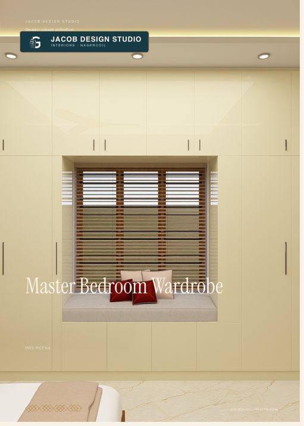
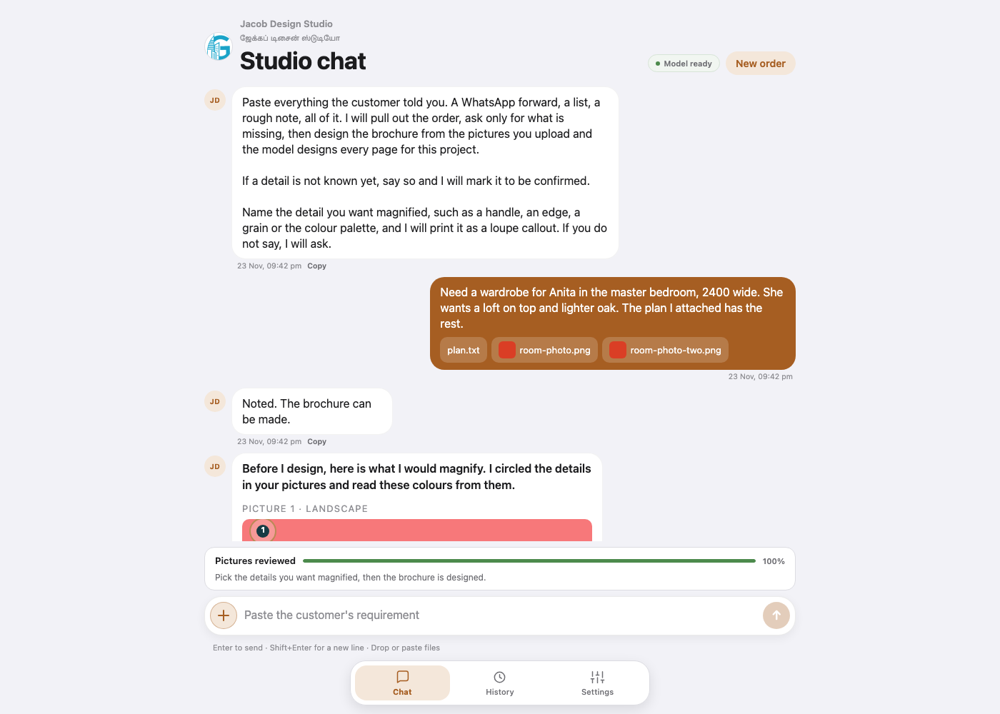
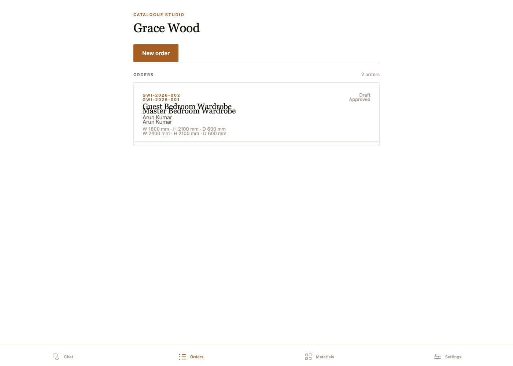

# Jacob Design Studio

An internal studio application for Jacob Design Studio, Nagercoil. A salesperson pastes what the customer asked for, attaches the project photographs, and the application designs and prints a customer brochure from those pictures.

One codebase: a phone app, a website and a standalone desktop application.

## One standalone app

The product is a single desktop application. The studio, the design engine, the local SQLite database and the print engine are inside the installer. There is no external server, no Python and no WeasyPrint on the customer's machine. A separate `npm run server` exists only for development from a checkout.

The only external service is the language model chosen in Settings. Everything else stays on the machine, and the server's egress guard enforces that.

## What it does

1. A salesperson pastes the customer requirement into the chat and attaches the project photographs.
2. The intake assistant pulls out the order and asks only for what is missing.
3. Before designing, the chat shows the pictures back with numbered circles on the details worth magnifying and the colours read from them, and asks what to magnify. The client answers in the chat.
4. The model designs and typesets a showroom brochure from the pictures: the kind a car or bike showroom hands over. Big hero photography, one idea per spread, named colour options like a paint card, feature callouts with magnified details, almost no text.
4. The PDF is previewed page by page and can be printed, opened or shared.

There is no template library and no pre-made layout. The model authors every page for that project.

## Pictures are the design

The photographs are the source, not decoration. The brochure is a colour study, not a specification sheet: there are no dimensions, sizes or shapes anywhere in the product.

- **Every uploaded picture is printed.** A document that leaves a picture out is rejected and asked for again. PDF sheets count as pictures too, through their first page.
- **The theme comes from the pictures.** The paper, ink, deep tone and accent of every brochure are computed from the colours read out of the client's photographs and handed to the designer as the page palette. Two projects never share a house palette.
- **The brand is always legible.** The mark, the brand name and the company details are printed on ready made brand and contact plates. Each plate carries its own solid ground, light or dark, with a keyline, so a pale photograph or a dark page can never fade them out. The cover takes a brand plate and the closing page takes a brand plate plus a contact plate with the phone, email and address.




- **The palette comes from the pictures and gets showroom names.** The engine decodes each photograph, then names its four dominant colours the way a paint card does: Warm Ivory, Oat, Sand Beige, Walnut. The brochure prints colour option strips, four named swatch chips with their hex values, so the pages mirror the project instead of an invented palette.
- **The pages look like the project.** Type, photographs and colour are composed to belong with the pictures supplied.
- **The picture review.** As soon as pictures are attached the studio analyses them and shows each picture back large, with magnified circles on the details worth seeing. Each circle is a four times enlarged cut of that same picture and is named with the colour inside it, name plus hex code, so the client reads Oat #C9B996 or Walnut #794617 at a glance. The palette is printed under the picture with every code, and the studio asks what to magnify before any brochure exists.
- **PDF sheets are unpacked page by page.** The studio can send the design as a PDF. Every page is rendered on the machine (up to twelve), and each page joins the review as its own picture with its own circles and palette. The brochure has to print every page, exactly like every photograph, so nothing a client sent is dropped.



- **Magnifier callouts.** Name a detail in the chat, such as a handle, an edge, a grain or the colour palette, and the model prints a circular loupe: the same photograph enlarged on that detail, a thin ring, a leader line and a small label. When pictures arrive without a named detail, the intake assistant asks which detail to magnify.


## Chat first

One chat is one order. It opens with the studio greeting, a date and time on every message, starter cards and a composer that takes typing, dragging or pasting.

- **Attachments**: any type up to 50 MB, picked, dragged or pasted. They wait in a tray with a thumbnail, size and remove button.
- **Never lost**: a failed send puts the message and files back in the composer and explains what happened.
- **The app reads the pictures, not asks for the brief.** Intake never asks for the room or the piece. It reads them from the pictures and the file names, says what it sees in one line and asks the customer to confirm. The only fact it asks for is who the customer is.
- **Nothing is invented**: a detail the customer does not know is marked to be confirmed, never guessed.
- **One conversation, one order**: after the brochure exists, every sentence edits that order. New order starts the next customer.

## Editing by conversation

After a brochure exists the same chat edits it. The sentence is applied to the order fields or the copy, then the designer is asked again with the brochure it already printed, so the design survives the edit. Examples: "make the shutters dark walnut", "magnify the brass handle", "shorten the headline", "the height is 2150".

Files can join late: attach a photograph with the next sentence and it is saved on the order and printed in the next brochure. Duplicates are ignored and the twenty file cap rejects the whole edit so nothing is half saved.

## Generated design

The model writes the words and authors the pages itself as HTML and CSS in one reply: four pages for a quiet order, up to eight when the photographs and their palettes need the room. The server supplies the print box, fonts, brand assets, the picture palettes and the words through tokens, then checks the document before printing.

The checks cover the page count, per page word limits, the copy printed once, every photograph used, every palette strip with its four named chips, a real magnifier plate with its colour name and code, a brand plate on the cover, a brand plate and contact plate on the closing page, a house motif, no external URL, and no unfilled token. A failure is asked for again with the exact problems; two failures print nothing.

The brochure carries the order's creation date. The story pages carry the copy, the colour pages carry the strips and chips, a premium spread carries the real magnifier loupe, and the closing page carries the brand and contact plates.

## Brand assets only

The installer ships brand identity and nothing else: the Jacob Design Studio mark, the house motifs (jaali, paisley, lotus, rangoli, temple arch), the fonts and the print engine. Every room photograph and every finish photograph arrives through the studio's upload. A finish without a photograph prints as its exact colour chip from the materials table. No stock room, no stock wood, no borrowed image reaches a customer document.

The info kit follows the same rule: brand panels, the white mark and house ornaments over cream, never somebody else's wardrobe.

## Screens


Chat. One order per conversation, pictures and requirement in one place.


Order detail. Specification, brochure pages, PDF, customer note and info kit. Every order shows the date and time it was created.



History. Every order the chat made, with the brochure it produced.

## Architecture

```
app/          Expo SDK 58, expo-router, React Native and web
server/       Node 24, Hono, node:sqlite, the design engine and print queues
templates/    brand assets, fonts, the info kit, legacy print layouts
data/         SQLite database, uploaded media, generated PDFs and pages
```

```
React Native app  ──HTTP──▶  Hono engine  ──SQLite──▶  orders and uploads
      ▲                         │
      │                         └── model ──▶ brochure HTML ──▶ print engine
      └──────── page images and PDF download ────────────────┘
```

## Quick start

Requirements: Node 24. The desktop build embeds its own print engine. The development server uses WeasyPrint and Poppler.

```bash
npm run setup      # installs server, app and desktop dependencies
npm run seed       # creates data/catalog.db with demo data
npm run dev        # engine on :8787 and the web app on :8081
```

Useful commands:

```bash
npm test           # server suite
npm run verify     # create an order, attach photos, render, check the PDF
npm run e2e        # drive the real web app in Chrome
npm run typecheck
npm run lint
npm run desktop    # run the standalone app in development
npm run build:mac  # dmg and zip in desktop/release
npm run build:win  # nsis and portable exe, best on Windows
```

## Desktop app

The installer contains the studio UI, the engine, the database and the print engine. On first launch the studio opens Settings, chooses a language model and pastes its key. PDFs are printed by Electron's Chromium through `desktop/pdf-engine.js`.

Data lives in `%APPDATA%\Jacob Design Studio\data` on Windows and `~/Library/Application Support/Jacob Design Studio/data` on macOS.

The Windows installer is a custom NSIS wizard in `desktop/installer/JacobStudio.nsi`: welcome, options, install, finish. It installs for the current user into `%LOCALAPPDATA%\Programs\Jacob Design Studio`, creates Start Menu and optional desktop shortcuts, registers an uninstall entry and upgrades cleanly without touching data. Builds are unsigned, so SmartScreen and Gatekeeper warn on first open.

`.github/workflows/desktop.yml` builds both platforms on every `v*` tag, verifies a silent install and uninstall on the Windows runner and attaches the installer and portable exe to the release.

## Language model

The studio ships presets for DeepSeek, OpenCode Zen Go, Command Code Provider, OpenAI, OpenRouter, Groq, Together, Mistral, Google Gemini, xAI Grok, Ollama, LM Studio and Custom, all through one OpenAI compatible layer. The endpoint stays editable; switching provider drops a stale endpoint. The key is stored on the machine and never returned to the app or logged. No API key ships with the app.

## Tests

```bash
npm test          # 121 server tests
npm run verify    # black box smoke test
npm run e2e       # 97 browser checks
npm run typecheck
npm run lint
```

The browser suite walks the product like a person: chat with date and time, picture-led intake, attachments, the colour chips read from the pictures, an order created the way the chat does, design, PDF, share, design again, note, info kit, edits, late files, settings, deep link, mobile and the API-down path. Screenshots land in `docs/screenshots/e2e/`.

## Offline by design

Everything except the model runs locally:

- The app, mark, motifs, fonts and print engine ship inside the installer. No CDN, no analytics, no update checks.
- The database is local SQLite; uploads, PDFs and page images live in the app data folder.
- The engine installs a network egress guard at boot: only the configured model provider and loopback may receive traffic.
- Print windows block every HTTP and HTTPS request, so a printed page can never pull a remote asset.
- Templates are audited for remote URLs and the guard has its own test.

## Production

The API can still run in a container: full runbook in [docs/DEPLOY.md](docs/DEPLOY.md) and the config template in [.env.example](.env.example). Health and readiness endpoints, request ids, rate limits, queued renders, retention and backups are documented there.

House rules for copy and interface: short sentences, no em dashes or en dashes, a middot for separators, say what the person should do next.
